# UML Guide (recordatorio para estudiantes)

Este documento explica, paso a paso y con lenguaje sencillo, como construir y leer diagramas UML de clases. La idea es que puedas entenderlos desde cero y mantenerlos claros.

## Para que sirve un diagrama de clases
Un diagrama de clases muestra la estructura del sistema:
- Que clases existen.
- Que datos tienen (atributos).
- Que hacen (metodos).
- Como se relacionan entre si.

No describe el flujo de ejecucion, sino la estructura.

## Elementos basicos
### Clase
Representa un concepto del sistema (ej. Pedido, Usuario, Factura).
Dentro de la clase se muestran:
- Atributos: datos que tiene la clase.
- Metodos: acciones que la clase puede hacer.

Un diagrama de clase se parece a una **ficha o formulario del concepto**: permite ver que datos y operaciones tiene. Pero una clase Java no deberia convertirse siempre en un simple formulario con getters y setters. Por ejemplo, `Jugador.recibirDanio(puntos)` puede proteger la regla de que la vida nunca sea negativa. Si todos los datos se exponen y las reglas se mueven a otra clase, podemos terminar en el mal olor *Data Class* (un objeto que solo transporta datos sin responsabilidad propia). Eso no convierte a todos los objetos de datos en un error: un `record ResultadoAtaque(int danio, boolean critico)` puede ser un buen resultado inmutable de una operacion.

### Interfaz
Define un contrato. En Java puede declarar metodos abstractos, `default`, `static` y privados, ademas de constantes; no es simplemente una clase sin codigo.

La realizacion se dibuja con **linea discontinua y triangulo hueco** hacia la interfaz. La alternativa compacta es el **circulo (lollipop)** que representa una interfaz proporcionada:

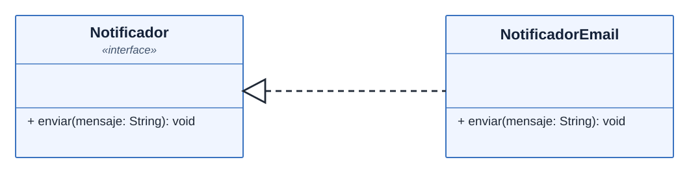

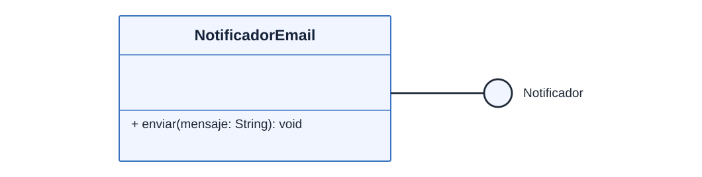

En ambos casos, `NotificadorEmail implements Notificador`. El circulo no es otra clase: muestra el contrato ofrecido.

### Clase abstracta
Es una clase que no se instancia directamente. Sirve como base para otras clases.
Puede tener metodos abstractos y metodos concretos.

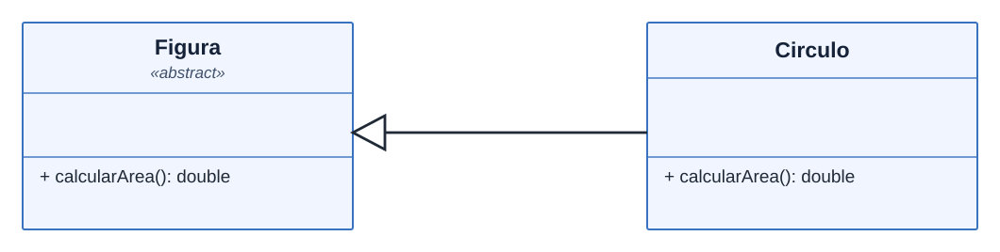

En Java: `abstract class Figura` y `class Circulo extends Figura`. La marca `«abstract»` identifica a la clase abstracta; `calcularArea()` se declara sin cuerpo en `Figura`.

### Enumeracion (`enum`)
Representa un **conjunto cerrado de valores** de un dominio, por ejemplo, estados permitidos de un pedido.


```java
enum EstadoPedido { PENDIENTE, PAGADO, CANCELADO }
```

Una clase `Pedido` puede declarar `private EstadoPedido estado;`. El tipo del atributo ya muestra la conexion; **no es obligatorio dibujar una flecha** hacia la enumeracion.

### Record de Java
Un `record` transporta un grupo fijo de datos y genera constructor, accesores, `equals`, `hashCode` y `toString`. Sus campos de componente son `private final` (inmutabilidad superficial).

```java
record PedidoResumen(long id, EstadoPedido estado) {}
```

Puede representarse como una clase con sus atributos y accesores. Usaremos `«record»` solo como **convencion explicita de este repositorio**, porque UML no define un simbolo propio estandar para el `record` de Java.


Si un metodo devuelve `PedidoResumen`, escribimos `+resumen(): PedidoResumen` en su clase. Si queremos destacar el uso temporal, podemos dibujar una dependencia `..>`. **El tipo `record` no determina la flecha**.

## Visibilidad (modificadores)
- Publico (+): se puede usar desde cualquier parte.
- Privado (-): solo dentro de la clase.
- Protegido (#): accesible segun las reglas de `protected` de Java (subclases y mismo paquete).
- Paquete (~): sin modificador, accesible dentro del paquete Java.

Para recordar: el signo te dice quien puede acceder a un atributo o metodo.

## Relaciones mas comunes (y como pensarlas)
### Herencia (es-un)
Una clase hija hereda de una clase padre.
Ejemplo mental: "Perro es un Animal".

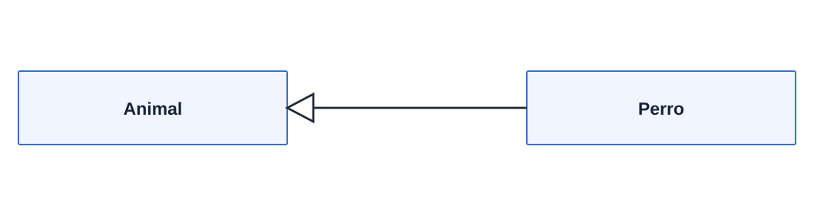

### Implementacion (cumple-un-contrato)
Una clase cumple una interfaz.
Ejemplo mental: "RepositorioSql implementa Repositorio".

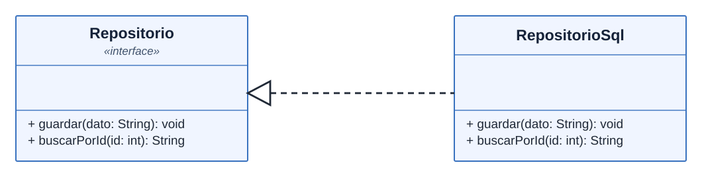

### Asociacion (se comunica con)
Una clase usa o conoce a otra.
Ejemplo mental: "Pedido usa Cliente".

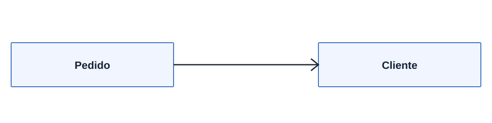

### Agregacion (tiene-una, pero puede vivir aparte)
Una clase contiene a otra, pero el contenido puede existir sin ella.
Ejemplo mental: "Equipo tiene Jugadores, y los Jugadores pueden existir sin el Equipo".

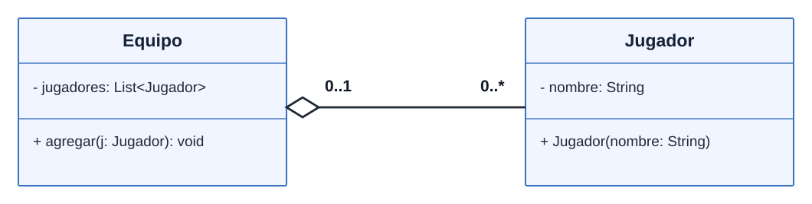

### Composicion (parte-de)
Una clase contiene a otra y su ciclo de vida depende de ella.
Ejemplo mental: "Casa tiene Habitaciones, si la Casa desaparece, las Habitaciones tambien".

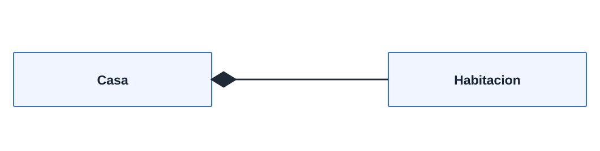

### Dependencia (uso temporal)
Una clase usa otra solo en un metodo o parametro.
Ejemplo mental: "Factura usa Impresora solo para imprimir".

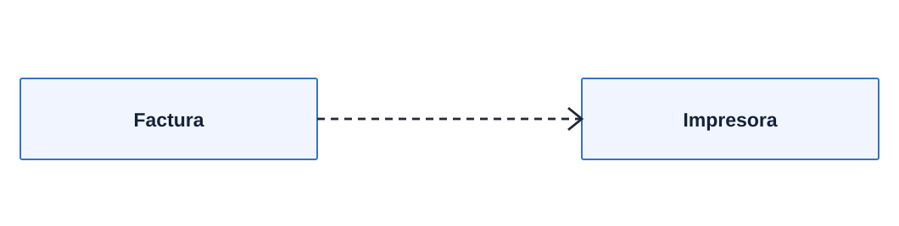

## Simbologia de relaciones (flechas y lineas)
Las lineas de los diagramas anteriores representan relaciones UML, no simples adornos:

- **Herencia:** linea continua y triangulo hueco hacia la clase padre.
- **Implementacion:** linea discontinua y triangulo hueco hacia la interfaz.
- **Asociacion:** linea continua; la flecha abierta indica hacia donde se puede navegar.
- **Agregacion:** rombo hueco del lado del todo (Equipo).
- **Composicion:** rombo relleno del lado del todo (Casa).
- **Dependencia:** linea discontinua y flecha abierta hacia la clase utilizada.

El triangulo indica *generalizacion o realizacion*; el rombo identifica el *todo*. La diferencia entre linea continua y discontinua tambien importa.

## Cardinalidad (cuantos hay)
Ayuda a indicar cantidades en una relacion:
- 1..1: exactamente uno.
- 0..1: opcional (puede no existir).
- 1..*: uno o muchos.
- 0..*: cero o muchos.

**Regla de lectura:** situa mentalmente una instancia de una clase y lee la multiplicidad **junto a la clase contraria**.

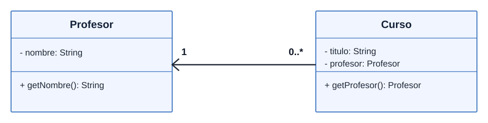

- Para cada **Profesor**, `0..*` en el extremo de **Curso** significa cero o muchos cursos.
- Para cada **Curso**, `1` en el extremo de **Profesor** significa exactamente un profesor.
- La flecha hacia `Profesor` expresa que `Curso` lo conoce; **no significa cardinalidad**.

Las multiplicidades son reglas propuestas del dominio, no garantias automaticas de `List`, `Map` o del compilador Java. Por ejemplo, el constructor de `Curso` tendria que impedir un profesor nulo si el dominio exige exactamente uno.

## Ejemplos concretos por relacion (con cardinalidad)
Cada ejemplo es inventado y muy simple, solo para entender la relacion.

### Herencia
Cardinalidad: no aplica (es una relacion de tipo).

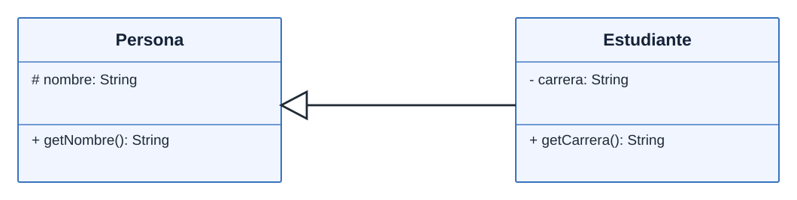
```java
package ejemplo.herencia;

class Persona {
    protected String nombre;

    public Persona(String nombre) {
        this.nombre = nombre;
    }

    public String getNombre() {
        return nombre;
    }
}

class Estudiante extends Persona {
    private String carrera;

    public Estudiante(String nombre, String carrera) {
        super(nombre);
        this.carrera = carrera;
    }

    public String getCarrera() {
        return carrera;
    }
}
```

### Implementacion
Cardinalidad: no aplica (es una relacion de contrato).


```java
package ejemplo.implementacion;

interface Repositorio {
    void guardar(String dato);
    String buscarPorId(int id);
}

class RepositorioSql implements Repositorio {
    @Override
    public void guardar(String dato) {
        // guardar en SQL (ejemplo)
    }

    @Override
    public String buscarPorId(int id) {
        return "dato-" + id;
    }
}
```

`@Override` permite que el compilador compruebe que el metodo realmente implementa o sobrescribe uno de un supertipo. No se anota un metodo simplemente porque se llame igual que otro.

### Asociacion
Cardinalidad sugerida: Profesor 0..* Cursos, Curso 1 Profesor.


```java
package ejemplo.asociacion;

class Profesor {
    private String nombre;

    public Profesor(String nombre) {
        this.nombre = nombre;
    }

    public String getNombre() {
        return nombre;
    }
}

class Curso {
    private String titulo;
    private Profesor profesor; // asociacion: Curso conoce a Profesor

    public Curso(String titulo, Profesor profesor) {
        this.titulo = titulo;
        this.profesor = profesor;
    }

    public Profesor getProfesor() {
        return profesor;
    }
}
```

**Aterrizaje Java:** `private Profesor profesor;` es una referencia persistente en `Curso`, no una lista. `Curso` conoce al profesor; no se necesita que `Profesor` mantenga una lista de cursos para dibujar la relacion conceptual. La regla `1` requiere validar que el profesor no sea nulo.

### Agregacion
Cardinalidad sugerida: Equipo 0..* Jugadores, Jugador 0..1 Equipo.


```java
package ejemplo.agregacion;

import java.util.ArrayList;
import java.util.List;

class Jugador {
    private String nombre;

    public Jugador(String nombre) {
        this.nombre = nombre;
    }
}

class Equipo {
    private List<Jugador> jugadores; // agregacion: jugadores pueden existir sin equipo

    public Equipo() {
        this.jugadores = new ArrayList<>();
    }

    /**
     * Incorpora un jugador a la plantilla; el jugador puede existir sin este equipo.
     *
     * @param jugador jugador que se incorporara
     */
    public void agregar(Jugador jugador) {
        jugadores.add(jugador);
    }
}
```

**Aterrizaje Java:** el rombo hueco corresponde al lado del *todo* (`Equipo`), pero **UML no obliga a usar `ArrayList` ni a guardar una referencia en `Jugador`**. Segun las reglas del dominio, el equipo podria almacenar:

| Estructura | Ventaja | Precaucion |
| --- | --- | --- |
| `ArrayList<Jugador>` | Orden de insercion y acceso por indice | Permite duplicados |
| `HashSet<Jugador>` | Evita duplicados segun `equals`/`hashCode` | No garantiza orden de iteracion |
| `HashMap<String, Jugador>` | Busca por codigo con rapidez habitual | Las claves deben ser unicas y estables |
| Grafo | Modela relaciones complejas entre jugadores y equipos | Es excesivo para una plantilla simple |

**Regla pendiente:** el ejemplo permite agregar el mismo jugador a varios equipos. La multiplicidad propuesta `0..1` solo se cumple si la aplicacion la valida. No debemos deducir reglas del negocio exclusivamente de la estructura de datos.

### Composicion
Cardinalidad sugerida: Orden 0..* Lineas, Linea 1 Orden.

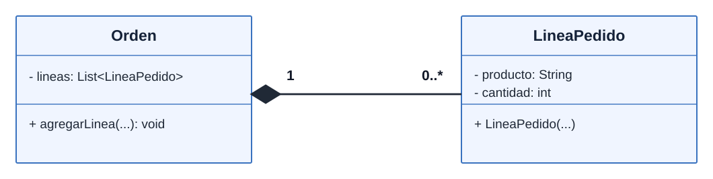
```java
package ejemplo.composicion;

import java.util.ArrayList;
import java.util.List;

class LineaPedido {
    private String producto;
    private int cantidad;

    public LineaPedido(String producto, int cantidad) {
        this.producto = producto;
        this.cantidad = cantidad;
    }
}

class Orden {
    private List<LineaPedido> lineas; // composicion: lineas viven con la orden

    public Orden() {
        this.lineas = new ArrayList<>();
    }

    /**
     * Crea una linea perteneciente a esta orden y la incorpora a sus detalles.
     *
     * @param producto producto solicitado
     * @param cantidad unidades solicitadas
     */
    public void agregarLinea(String producto, int cantidad) {
        lineas.add(new LineaPedido(producto, cantidad));
    }
}
```

**Aterrizaje Java:** `Orden` crea las `LineaPedido` internamente y controla la coleccion de detalles. Esto **ilustra** la composicion; la recoleccion de basura de Java no aplica por si sola una regla de negocio como "borrar todas las lineas al cancelar una orden". Esa politica se programa y se prueba.

### Dependencia
Cardinalidad: uso temporal, no estructura fija.

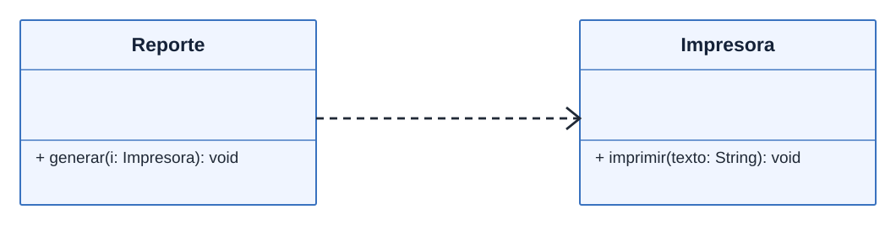
```java
package ejemplo.dependencia;

class Impresora {
    public void imprimir(String texto) { }
}

class Reporte {
    /**
     * Genera un reporte mediante la impresora recibida para esta llamada.
     *
     * @param impresora servicio temporal utilizado para imprimir
     */
    public void generar(Impresora impresora) { // dependencia: uso temporal
        impresora.imprimir("OK");
    }

    public void generarEnPantalla() {
        // No depende de Impresora en este metodo
    }
}
```

**Aterrizaje Java:** el parametro `Impresora impresora` se usa durante la llamada, pero `Reporte` no necesita conservarlo como atributo. Por eso dibujamos dependencia y no una asociacion persistente.

## Java, UML y reglas del dominio
Java define las reglas del lenguaje; UML representa el diseño, pero **ninguno determina por sí solo las reglas del negocio**. Antes de añadir cédula, teléfono o fecha de nacimiento a `Cliente`, hay que confirmar qué necesita el cliente y qué exige o permite la normativa aplicable.

Las multiplicidades mostradas son supuestos didácticos del dominio: **estos ejemplos Java no las validan automáticamente**.

Para aterrizar un diagrama, haz cuatro preguntas: **que relacion representa**, **como se lee**, **que referencia o estructura la implementaria en Java** y **que regla del dominio habria que probar**. Una lista, un mapa o un grafo son opciones de implementacion, no significados universales de un rombo UML.

## Operaciones, casos de uso y Javadoc
Un **caso de uso** describe un objetivo de un actor frente al sistema (por ejemplo, inscribir un estudiante). Un **metodo** es una operacion de software; un caso de uso puede coordinar varios metodos de varias clases. No asignes un codigo `CU-04` a cada metodo por costumbre: usalo solo cuando exista un requisito rastreable.

Javadoc usa comentarios `/** ... */` inmediatamente antes de la declaracion. Documenta **contratos y decisiones**, no una narracion obvia de cada linea:

```java
/**
 * Incorpora al jugador en el equipo si las reglas de inscripcion lo permiten.
 *
 * @param jugador participante que solicita la incorporacion
 * @throws IllegalStateException si el cupo del equipo esta completo
 */
public void inscribir(Jugador jugador) {
    // Aqui irian la validacion de cupo y el alta efectiva.
}
```

Este es un **ejemplo ilustrativo de contrato**, no un metodo implementado por el codigo simplificado anterior. Nunca documentes una excepcion o validacion que tu codigo realmente no realiza.

En cada patron, busca primero una intuicion visible (un semaforo, un personaje, un pedido o un dispositivo), luego la relacion UML, el codigo y una prueba de su comportamiento. El ejemplo debe ayudar a comprender, no convertirse en una analogia forzada.

## Como construir un diagrama desde cero
1) Lee el problema y subraya sustantivos: suelen ser clases.
2) Identifica responsabilidades: se vuelven metodos.
3) Identifica datos importantes: se vuelven atributos.
4) Define relaciones: herencia, composicion, asociacion, etc.
5) Revisa si faltan interfaces o abstracciones.
6) Simplifica: solo lo necesario para explicar el patron o el caso.

## Errores comunes de principiantes
- Meter demasiados detalles: el diagrama se vuelve dificil de leer.
- Confundir herencia con asociacion.
- Olvidar cardinalidades cuando son importantes.
- Dibujar flechas sin significado claro.

## Consejos para estudiar patrones de diseno
- En cada patron, destaca la relacion principal que lo define.
- Usa nombres consistentes con las clases del codigo.
- Si dudas, pregunta: "Que clase depende de cual?"
- Prioriza claridad sobre cantidad de detalles.

## Convenciones de este proyecto
- Un diagrama por patron.
- Los nombres del diagrama coinciden con el patron.
- El UML se usa para explicar estructura, no ejecucion.
- Los metodos publicos que definen contratos deben tener Javadoc con `@param`, `@return` y `@throws` cuando correspondan. No repitas un contrato heredado en cada `@Override` sin aportar informacion.
- Todos los diagramas de esta guia se muestran como SVG en `docs/uml/` para que sus relaciones sean visibles en GitHub sin depender del visor Mermaid del navegador.
