# UML Guide (recordatorio para estudiantes)

Este documento explica, paso a paso y con lenguaje sencillo, cómo construir y leer diagramas UML de clases. La idea es que puedas entenderlos desde cero y mantenerlos claros.

## Para qué sirve un diagrama de clases
Un diagrama de clases muestra la estructura del sistema:
- Qué clases existen.
- Qué datos tienen (atributos).
- Qué hacen (métodos).
- Cómo se relacionan entre sí.

No describe el flujo de ejecución, sino la estructura.

## Elementos básicos
### Clase
Representa un concepto del sistema (ej. Pedido, Usuario, Factura).
Dentro de la clase se muestran:
- Atributos: datos que tiene la clase.
- Métodos: acciones que la clase puede hacer.

Un diagrama de clase se parece a una **ficha o formulario del concepto**: permite ver qué datos y operaciones tiene. Pero una clase Java no debería convertirse siempre en un simple formulario con getters y setters. Por ejemplo, `Jugador.recibirDanio(puntos)` puede proteger la regla de que la vida nunca sea negativa. Si todos los datos se exponen y las reglas se mueven a otra clase, podemos terminar en el mal olor *Data Class* (un objeto que solo transporta datos sin responsabilidad propia). Eso no convierte a todos los objetos de datos en un error: un `record ResultadoAtaque(int danio, boolean critico)` puede ser un buen resultado inmutable de una operación.

### Interfaz
Define un contrato. En Java puede declarar métodos abstractos, `default`, `static` y privados, además de constantes; no es simplemente una clase sin código.

La realización se dibuja con **línea discontinua y triángulo hueco** hacia la interfaz. La alternativa compacta es el **círculo (lollipop)** que representa una interfaz proporcionada:

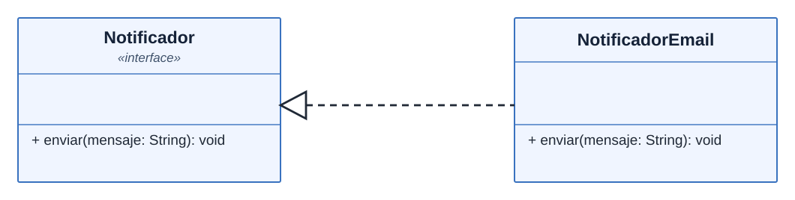

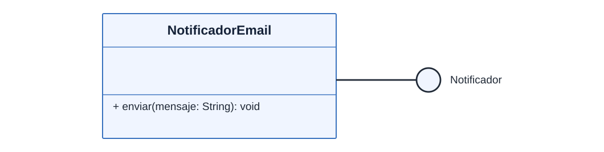

En ambos casos, `NotificadorEmail implements Notificador`. El círculo no es otra clase: muestra el contrato ofrecido.

### Clase abstracta
Es una clase que no se instancia directamente. Sirve como base para otras clases.
Puede tener métodos abstractos y métodos concretos.

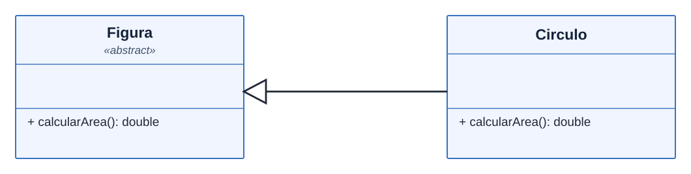

En Java: `abstract class Figura` y `class Circulo extends Figura`. La marca `«abstract»` identifica a la clase abstracta; `calcularArea()` se declara sin cuerpo en `Figura`.

### Enumeración (`enum`)
Representa un **conjunto cerrado de valores** de un dominio, por ejemplo, estados permitidos de un pedido.


```java
enum EstadoPedido { PENDIENTE, PAGADO, CANCELADO }
```

Una clase `Pedido` puede declarar `private EstadoPedido estado;`. El tipo del atributo ya muestra la conexión; **no es obligatorio dibujar una flecha** hacia la enumeración.

### Record de Java
Un `record` transporta un grupo fijo de datos y genera constructor, accesores, `equals`, `hashCode` y `toString`. Sus campos de componente son `private final` (inmutabilidad superficial).

```java
record PedidoResumen(long id, EstadoPedido estado) {}
```

Puede representarse como una clase con sus atributos y accesores. Usaremos `«record»` solo como **convención explícita de este repositorio**, porque UML no define un símbolo propio estándar para el `record` de Java.


Si un método devuelve `PedidoResumen`, escribimos `+resumen(): PedidoResumen` en su clase. Si queremos destacar el uso temporal, podemos dibujar una dependencia `..>`. **El tipo `record` no determina la flecha**.

## Visibilidad (modificadores)
- Público (+): se puede usar desde cualquier parte.
- Privado (-): solo dentro de la clase.
- Protegido (#): accesible según las reglas de `protected` de Java (subclases y mismo paquete).
- Paquete (~): sin modificador, accesible dentro del paquete Java.

Para recordar: el signo te dice quién puede acceder a un atributo o método.

## De clases Java a objetos y referencias

**Idea central:** Java implementa mecanismos (crear, recibir, guardar y usar objetos); UML describe vínculos y restricciones del modelo. **No existe una correspondencia automática entre `new`, `List` y un rombo UML.**

- **Clase:** define tipos, estado y comportamiento. `Curso` no es un objeto; `new Curso()` crea una instancia.
- **Instancia:** objeto concreto durante la ejecución; dos variables pueden señalar el *mismo* objeto.
- **Referencia:** permite localizar y utilizar un objeto. Un atributo `private Profesor profesor;` no crea un profesor.
- **Creación:** `new B()` construye una instancia; no prueba que exista composición.
- **Uso:** recibir `B` como parámetro o invocar sus métodos no exige construirlo ni guardarlo.
- **Propiedad en el modelo:** regla sobre a qué todo pertenece una parte; Java no la deduce de `List<B>` ni la garantiza automáticamente.

| Código observado | Conclusión segura | Lo que **no** demuestra |
| --- | --- | --- |
| `new B()` dentro de A | Se crea una instancia de B | Que A sea su dueño compuesto |
| `void operar(B b)` | A usa el tipo B en su operación | Que A guarde B como atributo |
| `private B b;` | A declara una referencia estructural a B | Que A haya creado B |
| `private List<B> elementos;` | A puede almacenar varias referencias a B | Agregación o composición |
| `b.operar()` | Se invoca una operación de B | Propiedad sobre B |

### Dos colecciones, una sola instancia

```java
import java.util.ArrayList;
import java.util.List;

class Estudiante {
    final String nombre;
    Estudiante(String nombre) { this.nombre = nombre; }
}

class Curso {
    final List<Estudiante> estudiantes = new ArrayList<>();
    void matricular(Estudiante estudiante) { estudiantes.add(estudiante); }
}

class Demo {
    public static void main(String[] args) {
        Estudiante ana = new Estudiante("Ana");
        Curso cursoA = new Curso();
        Curso cursoB = new Curso();
        cursoA.matricular(ana);
        cursoB.matricular(ana);
        System.out.println(cursoA.estudiantes.get(0) == cursoB.estudiantes.get(0)); // true
    }
}
```

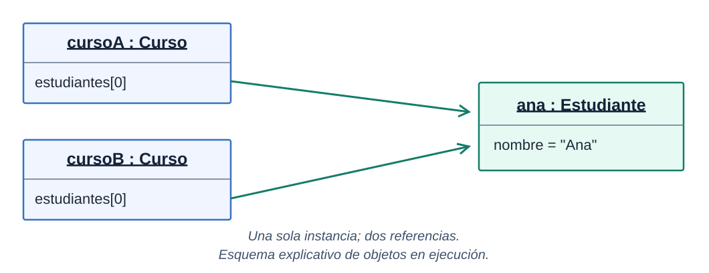

`ArrayList.add(ana)` almacena una **referencia**, no clona el objeto. El hecho de que ambas colecciones lo referencien es válido en Java. El **dominio** determina si una matrícula en dos cursos está permitida; el modelo puede añadir restricciones que el código debe verificar. Este SVG representa **objetos en ejecución**, no un diagrama de clases.

### Preguntas antes de dibujar una relación

1. ¿Qué clase declara atributos o métodos que mencionan a la otra? ¿Quién **crea**, **recibe**, **usa** o **guarda** instancias?
2. ¿Existe un vínculo estructural duradero en el modelo o solo una necesidad de uso? **Duradero** no significa eterno, y **dependencia** tampoco significa necesariamente temporal.
3. ¿El dominio considera un objeto como parte de otro? ¿Es una pertenencia débil o **propiedad compuesta exclusiva**?
4. ¿Qué multiplicidades, cambios de propietario, eliminaciones y validaciones son obligatorios?
5. ¿Qué garantiza realmente Java y qué necesita programarse y probarse?

## Relaciones más comunes (y cómo pensarlas)
### Herencia (es-un)
Una clase hija hereda de una clase padre.
Ejemplo mental: "Perro es un Animal".

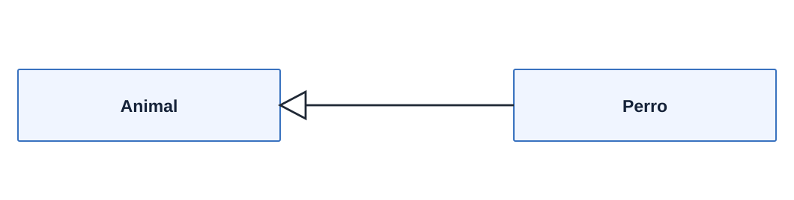

### Implementación (cumple-un-contrato)
Una clase cumple una interfaz.
Ejemplo mental: "RepositorioSql implementa Repositorio".

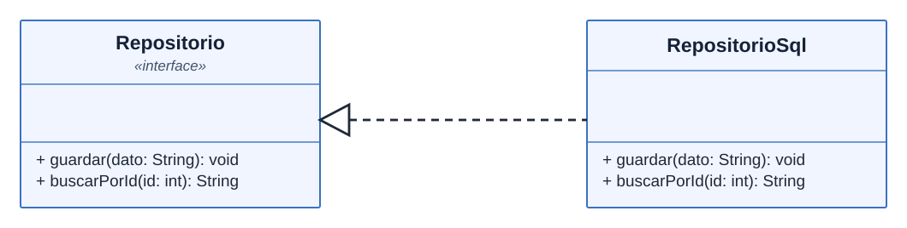

### Asociación (vínculo estructural)
Existe un vínculo estructural entre instancias de las clases. En Java, una implementación frecuente es que un objeto conserve una referencia al otro, pero el diagrama expresa el **modelo**, no la obligación de usar un campo concreto. No implica creación ni propiedad.
Ejemplo mental: "Cada Curso tiene asignado un Profesor".

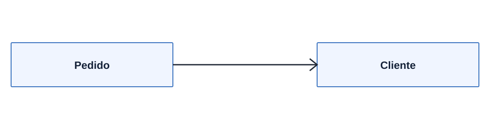

### Agregación compartida (todo-parte débil)
Un objeto agrupa otros como partes, pero estos conservan independencia respecto del todo. El rombo blanco representa una **interpretación explícita del dominio**, no una regla detectada porque aparezca `List`. La especificación UML deja el significado preciso de la agregación compartida al área de aplicación y al modelador; una asociación simple suele ser preferible cuando no hay una semántica todo-parte clara.
Ejemplo mental: "Equipo agrupa Jugadores; estos pueden continuar sin ese Equipo".

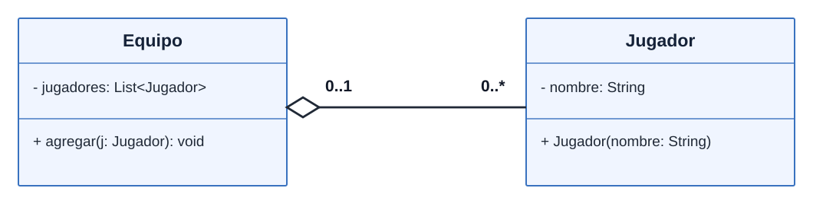

### Composición (todo-parte con propietario exclusivo)
Cada instancia que actúa como parte pertenece **como máximo a un objeto compuesto a la vez**. Si se destruye el compuesto en el modelo, se destruyen sus partes todavía asociadas; una parte puede **desvincularse antes** y después pertenecer a otro compuesto cuando las reglas lo permitan. No prohíbe que terceros tengan referencias a esa instancia, ni exige que su constructor se invoque dentro del todo.
Ejemplo mental: "Una LineaPedido pertenece como parte propia a una Orden; no simultáneamente a dos".

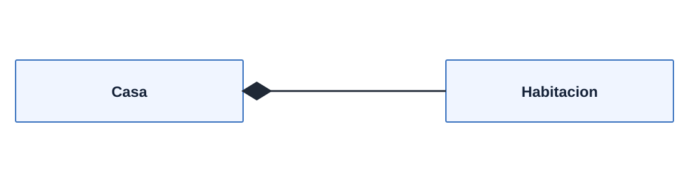

### Dependencia (necesita o utiliza)
Un elemento **cliente** depende de otro **proveedor** cuando cambiar el segundo podría afectar al primero. Recibir un parámetro, declarar un tipo, invocar una operación o utilizar una API son manifestaciones frecuentes. **No requiere `new` ni un atributo**, y no está restringida a infraestructura o al uso temporal.
Ejemplo mental: "Reporte utiliza una Impresora recibida para generar su salida".

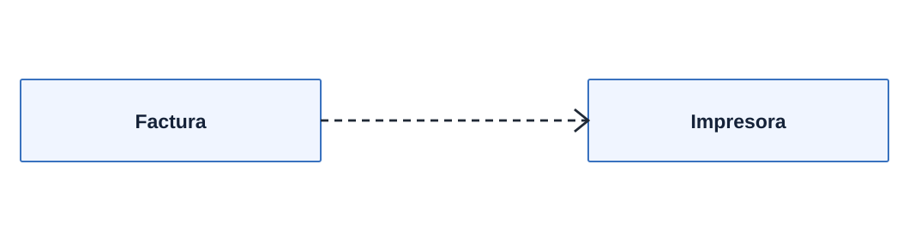

## Simbología de relaciones (flechas y líneas)
Las líneas de los diagramas anteriores representan relaciones UML, no simples adornos:

- **Herencia:** línea continua y triángulo hueco hacia la clase padre.
- **Implementación:** línea discontinua y triángulo hueco hacia la interfaz.
- **Asociación:** línea continua; la flecha abierta indica hacia dónde se puede navegar.
- **Agregación:** rombo hueco del lado del todo (Equipo).
- **Composición:** rombo relleno del lado del todo (Casa).
- **Dependencia:** línea discontinua y flecha abierta hacia la clase utilizada.

El triángulo indica *generalización o realización*; el rombo identifica el *todo*. La diferencia entre línea continua y discontinua también importa.

## Cardinalidad (cuántos hay)
Ayuda a indicar cantidades en una relación:
- 1..1: exactamente uno.
- 0..1: opcional (puede no existir).
- 1..*: uno o muchos.
- 0..*: cero o muchos.

**Regla de lectura:** sitúa mentalmente una instancia de una clase y lee la multiplicidad **junto a la clase contraria**.

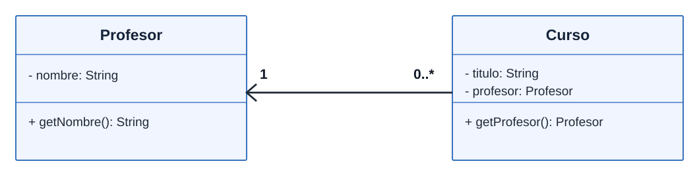

- Para cada **Profesor**, `0..*` en el extremo de **Curso** significa cero o muchos cursos.
- Para cada **Curso**, `1` en el extremo de **Profesor** significa exactamente un profesor.
- La flecha hacia `Profesor` expresa que `Curso` lo conoce; **no significa cardinalidad**.

Las multiplicidades son reglas propuestas del dominio, no garantías automáticas de `List`, `Map` o del compilador Java. Por ejemplo, el constructor de `Curso` tendría que impedir un profesor nulo si el dominio exige exactamente uno.

## Ejemplos concretos por relación (con cardinalidad)
Cada ejemplo es inventado y muy simple, solo para entender la relación.

### Herencia
Cardinalidad: no aplica (es una relación de tipo).

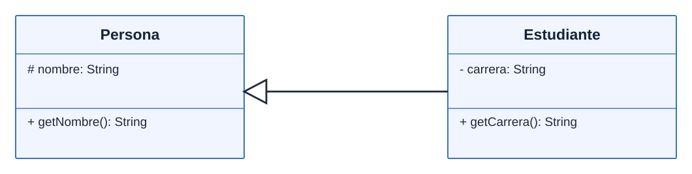
```java
package ejemplo.herencia;

class Persona {
    protected String nombre;

    public Persona(String nombre) {
        this.nombre = nombre;
    }

    public String getNombre() {
        return nombre;
    }
}

class Estudiante extends Persona {
    private String carrera;

    public Estudiante(String nombre, String carrera) {
        super(nombre);
        this.carrera = carrera;
    }

    public String getCarrera() {
        return carrera;
    }
}
```

### Implementación
Cardinalidad: no aplica (es una relación de contrato).


```java
package ejemplo.implementacion;

interface Repositorio {
    void guardar(String dato);
    String buscarPorId(int id);
}

class RepositorioSql implements Repositorio {
    @Override
    public void guardar(String dato) {
        // guardar en SQL (ejemplo)
    }

    @Override
    public String buscarPorId(int id) {
        return "dato-" + id;
    }
}
```

`@Override` permite que el compilador compruebe que el método realmente implementa o sobrescribe uno de un supertipo. No se anota un método simplemente porque se llame igual que otro.

### Asociación
Cardinalidad sugerida: Profesor 0..* Cursos, Curso 1 Profesor.


```java
package ejemplo.asociacion;

class Profesor {
    private String nombre;

    public Profesor(String nombre) {
        this.nombre = nombre;
    }

    public String getNombre() {
        return nombre;
    }
}

class Curso {
    private String titulo;
    private Profesor profesor; // asociación: Curso conoce a Profesor

    public Curso(String titulo, Profesor profesor) {
        this.titulo = titulo;
        this.profesor = java.util.Objects.requireNonNull(profesor);
    }

    public Profesor getProfesor() {
        return profesor;
    }
}
```

**Aterrizaje Java:** `private Profesor profesor;` declara una referencia conservada por `Curso`: no llama a un constructor ni crea otro `Profesor`. `Curso` puede recibir una instancia ya existente. No es necesario que `Profesor` almacene una lista de cursos para representar esta asociación navegable desde `Curso`. Si el dominio exige multiplicidad `1`, el constructor debe rechazar `null`, por ejemplo con `Objects.requireNonNull(profesor)`.

### Agregación
Cardinalidad sugerida: Equipo 0..* Jugadores, Jugador 0..1 Equipo.


```java
package ejemplo.agregacion;

import java.util.ArrayList;
import java.util.List;

class Jugador {
    private String nombre;

    public Jugador(String nombre) {
        this.nombre = nombre;
    }
}

class Equipo {
    private List<Jugador> jugadores; // agregación: jugadores pueden existir sin equipo

    public Equipo() {
        this.jugadores = new ArrayList<>();
    }

    /**
     * Incorpora un jugador a la plantilla; el jugador puede existir sin este equipo.
     *
     * @param jugador jugador que se incorporará
     */
    public void agregar(Jugador jugador) {
        jugadores.add(jugador);
    }
}
```

**Aterrizaje Java:** el rombo hueco corresponde al lado del *todo* (`Equipo`), pero **UML no obliga a usar `ArrayList` ni a guardar una referencia en `Jugador`**. Según las reglas del dominio, el equipo podría almacenar:

| Estructura | Ventaja | Precaución |
| --- | --- | --- |
| `ArrayList<Jugador>` | Orden de inserción y acceso por índice | Permite duplicados |
| `HashSet<Jugador>` | Evita duplicados según `equals`/`hashCode` | No garantiza orden de iteración |
| `HashMap<String, Jugador>` | Busca por código con rapidez habitual | Las claves deben ser únicas y estables |
| Grafo | Modela relaciones complejas entre jugadores y equipos | Es excesivo para una plantilla simple |

**Regla pendiente:** la implementación simplificada permite agregar el mismo jugador a varios equipos, **en contradicción con la multiplicidad ilustrativa `0..1`**. Si esa multiplicidad es una regla real, debe validarse. Por ejemplo, `Jugador` podría conservar su `Equipo` actual y rechazar otra inscripción hasta que se retire del primero; también habría que sincronizar ambas referencias sin dejar el modelo inconsistente. `List`, `Set` o `Map` no resuelven por sí solos la pertenencia. Si el dominio permite varios equipos a la vez, la multiplicidad también debe cambiar.

### Composición
Cardinalidad sugerida: Orden 0..* Líneas, Línea 1 Orden.

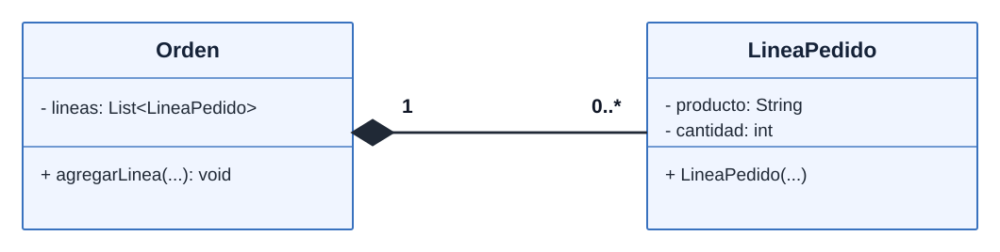
```java
package ejemplo.composicion;

import java.util.ArrayList;
import java.util.List;

class LineaPedido {
    private String producto;
    private int cantidad;

    public LineaPedido(String producto, int cantidad) {
        this.producto = producto;
        this.cantidad = cantidad;
    }
}

class Orden {
    private List<LineaPedido> lineas; // composición: las líneas viven con la orden

    public Orden() {
        this.lineas = new ArrayList<>();
    }

    /**
     * Crea una línea perteneciente a esta orden y la incorpora a sus detalles.
     *
     * @param producto producto solicitado
     * @param cantidad unidades solicitadas
     */
    public void agregarLinea(String producto, int cantidad) {
        lineas.add(new LineaPedido(producto, cantidad));
    }
}
```

**Aterrizaje Java:** `Orden` crea las `LineaPedido` internamente y mantiene la colección privada. Eso es una **estrategia para proteger** el modelo, pero **`new` dentro de `Orden` no prueba por sí solo composición**. Una línea también podría crearse externamente y entregarse a la orden, siempre que el sistema impida pertenencias compuestas simultáneas. Otras clases pueden consultarla; eso no las convierte en propietarias. Si la orden desaparece del **modelo de dominio**, sus líneas todavía asociadas desaparecen con ella; esto **no equivale** a que el recolector de basura de Java las libere inmediatamente ni a que cancelar una orden de negocio exija borrarla.

### Dependencia
Cardinalidad: uso temporal, no estructura fija.

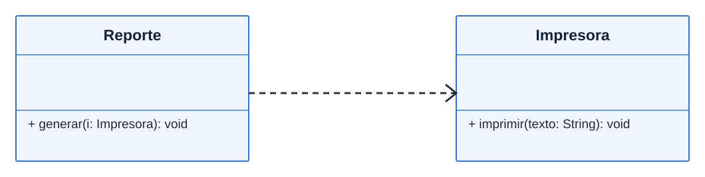
```java
package ejemplo.dependencia;

class Impresora {
    public void imprimir(String texto) { }
}

class Reporte {
    /**
     * Genera un reporte mediante la impresora recibida para esta llamada.
     *
     * @param impresora servicio temporal utilizado para imprimir
     */
    public void generar(Impresora impresora) { // dependencia: uso temporal
        impresora.imprimir("OK");
    }

    public void generarEnPantalla() {
        // No depende de Impresora en este método
    }
}
```

**Aterrizaje Java:** el parámetro `Impresora impresora` se utiliza durante la llamada, pero `Reporte` no necesita crearlo ni conservarlo como atributo. **Este ejemplo** se modela como dependencia. No todas las dependencias son temporales: la noción es más amplia que este patrón de código. Incluso `Math.abs(-5)` usa una clase sin crear una instancia.

## Ingeniería inversa: de Java a UML sin adivinar el dominio

Una herramienta que analiza Java puede identificar **hechos sintácticos**: `extends`, `implements`, tipos de campos, métodos, argumentos, invocaciones y colecciones. Algunas relaciones son directamente observables (generalización y realización); otras requieren interpretación.

| Indicio en el código | Inferencia razonable | Límite |
| --- | --- | --- |
| `extends` / `implements` | Generalización / realización | Puede omitirse del diagrama si no aporta al propósito |
| Parámetro o llamada a otra clase | Dependencia de uso o de tipo | No determina pertenencia |
| Campo `B b` o `List<B>` | Posible asociación estructural y multiplicidad candidata | No prueba rombo blanco o negro ni cardinalidad mínima |
| Instanciación `new B()` | Creación de objeto B | No implica composición |
| Campo `final` o colección privada | Restricciones sobre reasignación o acceso | No garantiza propietario exclusivo ni ciclo de vida |

**Procedimiento recomendado:** (1) identificar los indicios estructurales; (2) declarar explícitamente los supuestos del dominio; (3) elegir las relaciones UML compatibles; (4) establecer multiplicidades e invariantes; (5) revisar el código y pruebas que hacen cumplir esas invariantes. Cuando una herramienta propone agregación o composición sin dichas reglas, trátala como **hipótesis**, no como verdad demostrada.

Una clase de infraestructura (`Impresora`, `ClienteHttp`) puede participar en asociaciones, y dos clases de dominio pueden relacionarse por dependencia. Los nombres de los paquetes **no determinan** la flecha UML.

## Invariantes y validaciones: el código debe cumplir el diagrama

La multiplicidad `1` no aparece mágicamente por escribir `private Profesor profesor;`. Para exigir que todo curso tenga profesor:

```java
import java.util.Objects;

class CursoValidado {
    private final Profesor profesor;
    CursoValidado(Profesor profesor) {
        this.profesor = Objects.requireNonNull(profesor, "profesor obligatorio");
    }
}
```

En una composición `Orden`—`LineaPedido`, una estrategia defensiva consiste en **no exponer una colección modificable** y no aceptar una línea ya perteneciente a otra orden. Un ejemplo autocontenido de esa estrategia:

```java
import java.util.ArrayList;
import java.util.List;
import java.util.Objects;

class OrdenSegura {
    private final List<LineaSegura> lineas = new ArrayList<>();

    public void agregarLinea(String producto, int cantidad) {
        lineas.add(new LineaSegura(this, producto, cantidad));
    }

    public List<LineaSegura> lineas() {
        return List.copyOf(lineas);
    }
}

final class LineaSegura {
    private final OrdenSegura orden;
    private final String producto;
    private final int cantidad;

    // Solo OrdenSegura puede crear líneas en este ejemplo si ambas
    // clases se anidan, o si se controla la construcción por otro medio.
    LineaSegura(OrdenSegura orden, String producto, int cantidad) {
        this.orden = Objects.requireNonNull(orden);
        this.producto = Objects.requireNonNull(producto);
        if (cantidad <= 0) throw new IllegalArgumentException("cantidad");
        this.cantidad = cantidad;
    }

    OrdenSegura orden() { return orden; }
}
```

**Advertencia precisa:** el constructor de `LineaSegura` tiene visibilidad de paquete, así que **este código aislado todavía no impide** que otra clase del mismo paquete fabrique líneas sin registrarlas. Para una garantía más fuerte habría que restringir la construcción (por ejemplo, con una clase interna privada) y comprobar todas las rutas de modificación. La demostración sirve para identificar qué invariantes faltan; no se presenta como una implementación cerrada de todas las reglas.

## Java, UML y reglas del dominio
Java define las reglas del lenguaje; UML representa el diseño, pero **ninguno determina por sí solo las reglas del negocio**. Antes de añadir cédula, teléfono o fecha de nacimiento a `Cliente`, hay que confirmar qué necesita el cliente y qué exige o permite la normativa aplicable.

Las multiplicidades mostradas son supuestos didácticos del dominio: **estos ejemplos Java no las validan automáticamente**.

Para aterrizar un diagrama, responde: **qué objetos se crean, reciben, usan o referencian**, **qué vínculo representa el diagrama**, **cómo se lee su multiplicidad**, **qué regla del dominio la justifica** y **cómo se implementa y prueba esa regla**. No confundas la creación con la propiedad ni la referencia con la copia del objeto. Una lista, un mapa o un grafo son opciones de implementación, no significados universales de un rombo UML.

## Operaciones, casos de uso y Javadoc
Un **caso de uso** describe un objetivo de un actor frente al sistema (por ejemplo, inscribir un estudiante). Un **método** es una operación de software; un caso de uso puede coordinar varios métodos de varias clases. No asignes un código `CU-04` a cada método por costumbre: úsalo solo cuando exista un requisito rastreable.

Javadoc usa comentarios `/** ... */` inmediatamente antes de la declaración. Documenta **contratos y decisiones**, no una narración obvia de cada línea:

```java
/**
 * Incorpora al jugador en el equipo si las reglas de inscripción lo permiten.
 *
 * @param jugador participante que solicita la incorporación
 * @throws IllegalStateException si el cupo del equipo esta completo
 */
public void inscribir(Jugador jugador) {
    // Aquí irían la validación de cupo y el alta efectiva.
}
```

Este es un **ejemplo ilustrativo de contrato**, no un método implementado por el código simplificado anterior. Nunca documentes una excepción o validación que tu código realmente no realiza.

En cada patrón, busca primero una intuición visible (un semáforo, un personaje, un pedido o un dispositivo), luego la relación UML, el código y una prueba de su comportamiento. El ejemplo debe ayudar a comprender, no convertirse en una analogía forzada.

## Cómo construir un diagrama desde cero
1) Lee el problema y subraya sustantivos como **candidatos**, no como clases obligatorias. Evalúa identidad, estado, responsabilidades y límites del dominio.
2) Identifica responsabilidades: se vuelven métodos.
3) Identifica datos importantes: se vuelven atributos.
4) Define relaciones: herencia, composición, asociación, etc.
5) Revisa si faltan interfaces o abstracciones.
6) Simplifica: solo lo necesario para explicar el patrón o el caso.

## Errores comunes de principiantes
- Meter demasiados detalles: el diagrama se vuelve difícil de leer.
- Confundir herencia con asociación.
- Olvidar cardinalidades cuando son importantes.
- Dibujar flechas sin significado claro.
- Concluir que `List<B>` significa agregación, o que `new B()` implica composición.
- Confundir compartir una referencia con duplicar una instancia.
- Suponer que un diagrama generado automáticamente conoce las reglas del dominio.
- Creer que composición prohíbe que otras clases referencien las partes.

## Consejos para estudiar patrones de diseño
- En cada patrón, destaca la relación principal que lo define.
- Usa nombres consistentes con las clases del código.
- Si dudas, pregunta: «¿Qué clase depende de cuál?»
- Prioriza claridad sobre cantidad de detalles.

## Convenciones de este proyecto
- Un diagrama por patrón.
- Los nombres del diagrama coinciden con el patrón.
- El UML se usa para explicar estructura, no ejecución.
- Los métodos públicos que definen contratos deben tener Javadoc con `@param`, `@return` y `@throws` cuando correspondan. No repitas un contrato heredado en cada `@Override` sin aportar información.
- Todos los diagramas de esta guía se muestran como SVG en `docs/uml/` para que sus relaciones sean visibles en GitHub sin depender del visor Mermaid del navegador.
