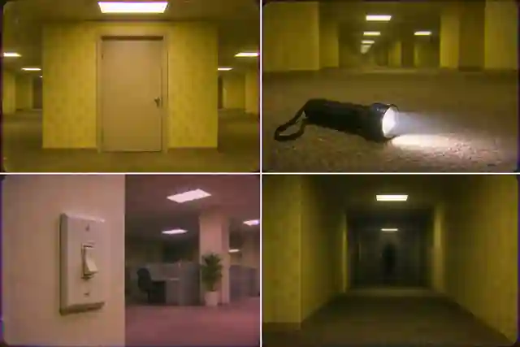
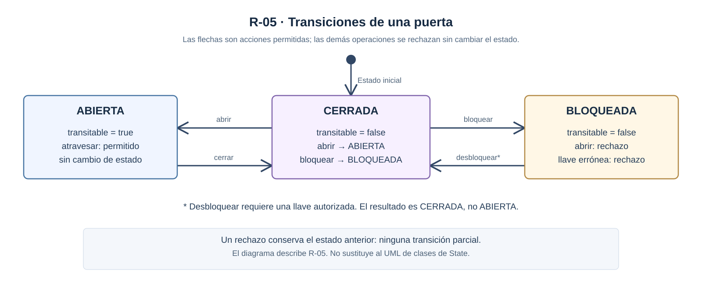
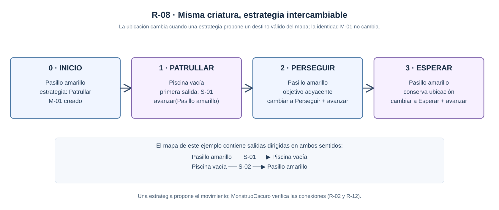
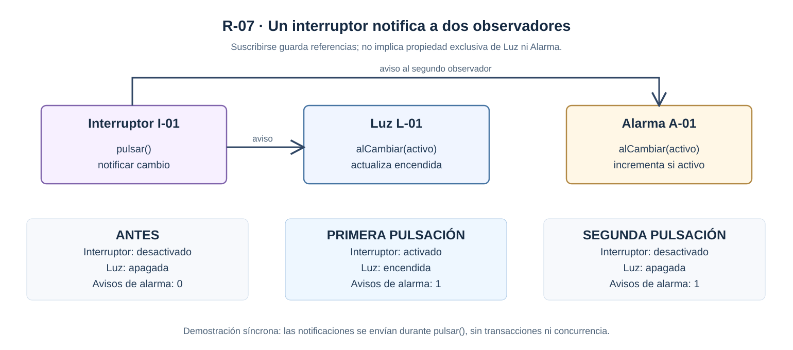

# Atlas visual del dominio — Expedición Liminal

> Una imagen ayuda a **imaginar** un escenario. Una regla del [dominio](DOMINIO.md) determina qué es cierto. Un patrón de diseño decide **cómo se organiza el código** para respetar esas reglas.

## 1. Pasillos amarillos

**Mira:** varias habitaciones parecen iguales. Hay un pasillo y entradas a otros espacios. El aspecto sirve para imaginar un recorrido; **no** significa que dos habitaciones visualmente iguales sean el mismo objeto Java.

**En el dominio:** una habitación tiene identidad propia (R-01). Para desplazarse debe existir una salida dirigida (R-02 y R-04). Si una puerta impide el paso, debe cumplirse su contrato de estados (R-05).

**En el código:** `Habitacion` representa lugares identificables; `Puerta` conserva un estado; `MonstruoOscuro` puede cambiar su estrategia sin duplicarse.

**Estudia aquí:** [State](docs/patrones/comportamiento/state.md), [Strategy](docs/patrones/comportamiento/strategy.md), [Facade](docs/patrones/estructurales/facade.md), [Builder](docs/patrones/creacionales/builder.md) y [Flyweight](docs/patrones/estructurales/flyweight.md).

## 2. Piscinas vacías

**Mira:** la ambientación parece muy diferente, pero eso no autoriza por sí solo reglas nuevas para caminar, crear habitaciones o atravesar puertas.

**En el dominio:** los ambientes son configuraciones intercambiables (R-13). No cambia automáticamente la identidad ni la ubicación válida de las entidades (R-01 y R-03).

**En el código:** una fábrica puede generar luces y puertas con apariencia propia de las piscinas, pero debe mantener la compatibilidad de productos; un iterador permite recorrer las habitaciones.

**Estudia aquí:** [Abstract Factory](docs/patrones/creacionales/abstractfactory.md), [Iterator](docs/patrones/comportamiento/iterator.md) y [Template Method](docs/patrones/comportamiento/templatemethod.md).

## 3. Oficinas oníricas

**Mira:** lámparas, salones y pasillos conocidos producen un ambiente extraño. Puedes imaginar que un interruptor avisa a varios dispositivos o que una cámara muestra una habitación, aunque esas acciones **no se ven** en la ilustración.

**En el dominio:** la señalización y las notificaciones siguen R-07. La simulación es discreta y reproducible (R-11).

**En el código:** `Interruptor` notifica observadores, `ProxyCamara` controla una consulta, y `InterpreteOrdenes` convierte textos del ejemplo en acciones.

**Estudia aquí:** [Observer](docs/patrones/comportamiento/observer.md), [Proxy](docs/patrones/estructurales/proxy.md), [Interpreter](docs/patrones/comportamiento/interpreter.md) y [Mediator](docs/patrones/comportamiento/mediator.md).

## 4. Objetos que puedes reconocer en las escenas

Son **cuatro referencias visuales independientes**, ordenadas de izquierda a derecha y de arriba abajo. No son una secuencia temporal ni demuestran reglas por sí solas.

**Puerta cerrada:** en [State](docs/patrones/comportamiento/state.md) se modela si abrir, cerrar o atravesar es válido según el estado (R-05). Una puerta dibujada no demuestra que todas las salidas tengan una.

**Linterna:** en [Decorator](docs/patrones/estructurales/decorator.md) una mejora envuelve la linterna sin copiarla. En el dominio, una linterna portable no puede estar físicamente en dos inventarios al mismo tiempo (R-06).

**Interruptor:** en [Observer](docs/patrones/comportamiento/observer.md) puede notificar luces y alarmas sin convertirse en dueño de esos receptores (R-07).

**Monstruo oscuro:** en [Strategy](docs/patrones/comportamiento/strategy.md) puede cambiar de patrullar a perseguir sin convertirse en otra criatura (R-08). Su silueta en la imagen no determina su ubicación válida ni la lógica del movimiento.

[Ver procedencia y ficha de la lámina](assets/README.md).

## 5. Qué cambia cuando se ejecuta el código

Estas tres láminas técnicas **complementan**, pero no sustituyen, los UML de clases. Se basan en los métodos reales de los clientes Java y en las reglas R-05, R-08 y R-07.

### Puerta — State

En [State](docs/patrones/comportamiento/state.md), la puerta tiene un solo estado en cada momento. Abrir desde BLOQUEADA no es una transición válida, aunque el método exista en la interfaz.

### Monstruo — Strategy

En [Strategy](docs/patrones/comportamiento/strategy.md), la referencia a la estrategia cambia. `MonstruoOscuro` verifica los destinos propuestos y conserva su ID.

### Interruptor — Observer

En [Observer](docs/patrones/comportamiento/observer.md), una pulsación notifica a los receptores existentes. La alarma incrementa su contador solo cuando el valor notificado es verdadero.

## Método de estudio: de la imagen al patrón

1. Describe en una frase qué **ocurre** en la escena imaginada.
2. Busca qué reglas R-XX lo permiten o prohíben en [DOMINIO.md](DOMINIO.md). Si no existe la regla, declara un supuesto local en lugar de inventar un hecho.
3. Lee el **UML** de la ficha y señala clases, interfaces y relaciones que sí se justifican.
4. Sigue la clase cliente Java: ¿qué instancia se crea, qué referencia se guarda y qué método se invoca?
5. Mira la salida de consola y la prueba que demuestra el comportamiento. Compara el diseño con una solución sin el patrón.

**Ejemplo de precisión:** ver dos lámparas en una imagen no establece una agregación UML. Un `List<Luz>` tampoco establece composición. La propiedad todo-parte debe salir de las reglas del dominio, no del dibujo ni de `new`.

Para consultar los archivos y su procedencia, abre la [galería de recursos](assets/README.md).
