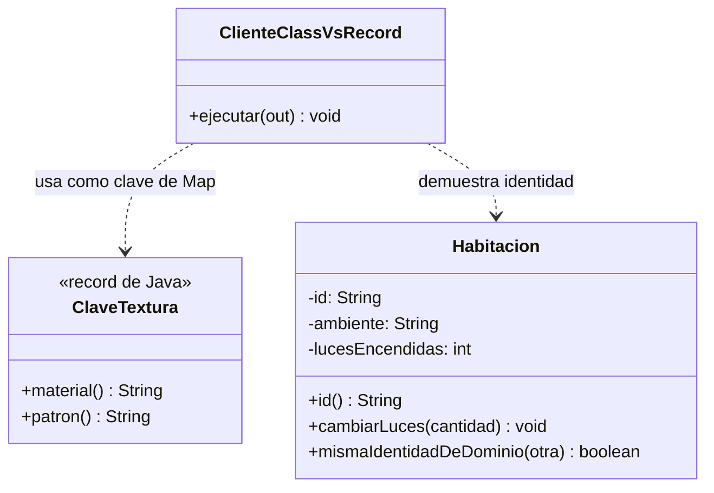

# `class` y `record` — elección de ingeniería, no una variante GoF


**Propósito:** justificar cuándo merece la pena un `record` en Java 21 sin modificar los ejemplos clásicos de los 23 patrones. Esta escena utiliza **texturas de pasillos** (valores) y **habitaciones** (entidades).

## 1. La decisión del dominio antes del lenguaje

| Aspecto | `ClaveTextura` (`record`) | `Habitacion` (`class`) |
| --- | --- | --- |
| Qué representa | Una configuración identificada por sus **valores** | Un lugar con **ID propio y estado** |
| Qué importa | Material y patrón | Identidad de dominio y cambios válidos |
| Igualdad elegida | Misma pareja de componentes | No se define `equals()` por defecto: distinguimos explícitamente referencia Java e ID de dominio |
| Mutabilidad | Componentes `String`, inmutables | Puede cambiar el número de luces |
| Caso de ingeniería | Clave de `HashMap` para reutilizar texturas | Entidad que conserva identidad al actualizar estado |

**Por qué sí importa `record` aquí:** dos instancias `new ClaveTextura("alfombra", "amarillo repetido")` son distintas en memoria, pero el `equals()` y `hashCode()` generados permiten que ambas consulten **la misma clave** de la caché. Es una propiedad funcional del ejemplo, no una preferencia por escribir menos código.

**Por qué una clase en la habitación:** una entidad necesita distinguir identidad, estado e invariantes. Un `record` con todos sus campos implicaría igualdad por componentes, que no es necesariamente la política correcta para una entidad. Tampoco una clase impone automáticamente igualdad por ID: hay que decidirla.

**Ojo:** un record **no garantiza inmutabilidad profunda**. Un componente que contiene una lista mutable puede seguir mutando si no hacemos copia defensiva. Los records son clases finales especiales con componentes y operaciones generadas; en UML pueden representarse como clases. `«record»` puede ser una anotación útil del proyecto, **no un estereotipo estándar universal de UML**.

## 2. Qué ejecuta el cliente

[ClienteClassVsRecord.java](../../../src/main/java/liminal/laboratorios/java/classvsrecord/ClienteClassVsRecord.java) tiene dos pasos nombrados:

1. `demostrarClaveDeTextura()`: crea dos valores equivalentes, almacena uno como clave y consulta con el otro.
2. `demostrarEntidadConIdentidad()`: construye dos instancias distintas con el mismo ID (aún no insertadas en un mapa), compara referencia e identidad conceptual y actualiza las luces de una.

Salida esperada:

```text
RECORD: dos claves equivalentes -> true
CACHE: consultar con otra clave -> Textura cargada una vez
CLASS: misma instancia Java -> false
DOMINIO: mismo ID -> true
ESTADO: luces de H-01 -> 3
```

**Matiz R-01:** el laboratorio muestra dos objetos con igual ID para ilustrar que las instancias y la identidad conceptual no son lo mismo; **no se registran simultáneamente en ningún mapa**, donde sí estaría prohibido duplicar el ID. El laboratorio no simula dos habitaciones activas de una misma expedición.

## 3. Diagrama UML mínimo



Este laboratorio **no es un patrón número 24**. El `Map` contiene asociaciones a claves, no declara composición UML por el hecho de almacenar objetos.

## 4. Abrir código y comprobar

- [ClaveTextura.java](../../../src/main/java/liminal/laboratorios/java/classvsrecord/ClaveTextura.java)
- [Habitacion.java](../../../src/main/java/liminal/laboratorios/java/classvsrecord/Habitacion.java)
- [PruebaClassVsRecord.java](../../../src/test/java/liminal/laboratorios/java/classvsrecord/PruebaClassVsRecord.java)

Después de compilar la colección con `bash colecciones/liminal/scripts/verificar.sh`, desde la raíz del repositorio:

```bash
java -cp colecciones/liminal/out liminal.laboratorios.java.classvsrecord.ClienteClassVsRecord
```

[Reglas normativas del mundo](../../../DOMINIO.md) · [Plan de variantes](../../../PLAN_VARIANTES.md) · [Guía de modelado de dominio](../../../../../docs/modelado/COMO_DEFINIR_UN_DOMINIO.md).
