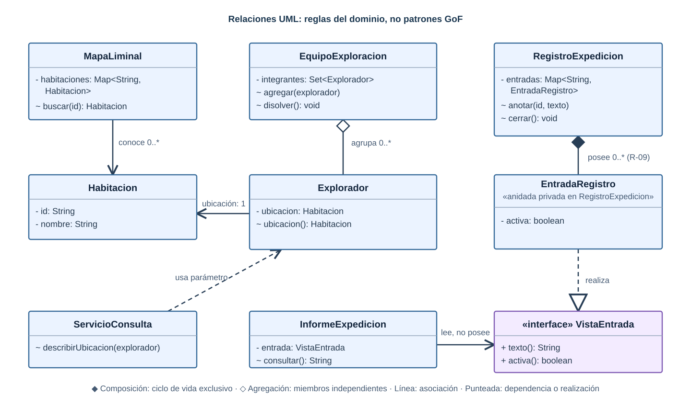
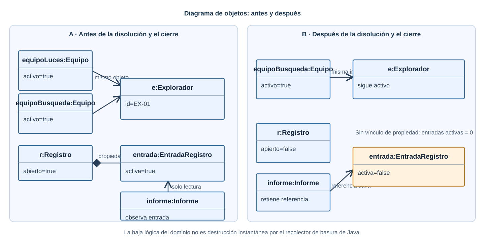

# Laboratorio UML: ¿quién conoce, agrupa y posee a quién?


**Este laboratorio NO es el patrón GoF Composite.** Es una práctica independiente sobre relaciones UML, reglas del dominio y Java 21 por consola.

> **Pregunta central:** si dos objetos Java referencian al mismo objeto, ¿ambos son sus propietarios? **No.** La respuesta depende de las reglas del dominio, no de cuántas variables o listas lo referencien.

## 1. Primero, las reglas

El contrato normativo está en [DOMINIO.md](../../DOMINIO.md).

| Regla | Restricción | Cómo se comprueba |
| --- | --- | --- |
| **R-01** | IDs válidos y únicos por colección de identidad | El mapa y el registro rechazan IDs duplicados |
| **R-03** | Un explorador activo tiene exactamente una habitación actual válida | Su ubicación es una referencia a una habitación del mapa |
| **R-09** | Toda entrada activa tiene exactamente un propietario compuesto | El registro crea sus entradas y las invalida al cerrarse |
| **R-10** | Guardar una referencia no crea una copia; `new` no determina composición | Se compara identidad con `==` |
| **R-12** | Un rechazo no deja mutaciones parciales | Una entrada duplicada no altera el registro |

**LAB-UML-01 (regla local):** un `EquipoExploracion` agrupa exploradores independientes. Un explorador puede pertenecer a varios equipos y sobrevive a la disolución de cualquiera de ellos. Elegimos expresamente **agregación compartida**, aunque en otros dominios una asociación simple sería más apropiada.

**LAB-UML-02 (regla local):** `RegistroExpedicion.cerrar()` invalida sus entradas y las elimina de la colección de **entradas activas del modelo**. No promete destruir las instancias de memoria ni borrar datos persistidos.

## 2. Diagrama de clases



| Relación | Clases | Qué significa |
| --- | --- | --- |
| Asociación (línea simple) | `Explorador → Habitacion` | Conoce su ubicación, pero no es dueño de la habitación |
| Agregación compartida (rombo **blanco**) | `EquipoExploracion ◇— Explorador` | Agrupa miembros que existen independientemente del equipo |
| Composición (rombo **negro**) | `RegistroExpedicion ◆— EntradaRegistro` | Una entrada activa pertenece exclusivamente a un registro y su vida **en el modelo** depende de él |
| Dependencia (línea discontinua) | `ServicioConsulta ⇢ Explorador` | Lo recibe como parámetro, sin guardarlo como atributo |
| Asociación de lectura | `InformeExpedicion → VistaEntrada` | Consulta, pero no se vuelve otro dueño |
| Realización (triángulo hueco) | `EntradaRegistro ⇢ VistaEntrada` | La clase privada implementa la interfaz de lectura |

**Los rombos van del lado del «todo»**, junto a `EquipoExploracion` o `RegistroExpedicion`. No se dibujan porque alguien use una lista o llame a un constructor.

## 3. Diagrama de objetos: antes y después



**Antes:** dos equipos mantienen referencias al **mismo** explorador. Un registro posee una entrada y un informe consulta esa misma entrada.

**Después:** al disolver `Luces`, el explorador continúa existiendo y el otro equipo lo conserva. Al cerrar el registro, la entrada se retira de su colección y pasa a `activa=false`. El informe todavía puede tener la referencia Java, pero **ya no existe una parte activa del dominio**.

Invariantes expresados formalmente:

- R-09: para cada entrada activa \(a\), \(\lvert propietariosCompuestos(a)\rvert = 1\).
- R-03: para cada explorador activo \(e\), \(\lvert ubicacionesActuales(e)\rvert = 1\).
- LAB-UML-01: \(\lvert equipos(e)\rvert \geq 0\); un explorador puede formar parte de más de uno.
- LAB-UML-02: después de `registro.cerrar()`, `entradasActivas(registro) == 0`, aun si alguien conserva una referencia Java.

## 4. Leer las instancias en Java

Empieza por [ClienteRelacionesUml.java](../../src/main/java/liminal/laboratorios/relaciones/ClienteRelacionesUml.java), que es un cliente autónomo.

```java
Habitacion pasillo = new Habitacion("H-01", "Pasillo amarillo");
MapaLiminal mapa = new MapaLiminal("MAPA-01");
mapa.agregarHabitacion(pasillo);
Explorador e = new Explorador("EX-01", mapa, "H-01");

boolean mismaInstancia = e.ubicacion() == pasillo; // true
```

`mapa.agregarHabitacion(pasillo)` **conserva una referencia**, no copia la habitación. El registro, por su parte, crea sus entradas en una clase anidada privada y entrega `VistaEntrada`: el código externo puede consultarlas, pero no transferirlas a otro registro mediante su API.

## 5. Consola y pruebas

Una vez compilado con el verificador de la colección, ejecuta desde la raíz del repositorio:

```bash
java -cp colecciones/liminal/out liminal.laboratorios.relaciones.ClienteRelacionesUml
```

Salida esperada:

```text
ASOCIACIÓN: EX-01 está en H-01
MISMA REFERENCIA: true
AGREGACIÓN: explorador en dos equipos: true
DISOLVER equipo: explorador sigue en H-01
OTRO equipo conserva referencia: true
COMPOSICIÓN: REG-01 tiene 1 entrada activa
INFORME consulta misma instancia: true
CIERRE: entradas activas = 0
REFERENCIA Java todavía existe: true
ENTRADA activa: false
INFORME tras cierre: entrada no disponible
```

[PruebaRelacionesUml.java](../../src/test/java/liminal/laboratorios/relaciones/PruebaRelacionesUml.java) comprueba referencias `==`, rechazos sin cambios parciales, pertenencia simultánea a equipos, disolución, cierre lógico y salida reproducible. **Se verifica junto a los 23 patrones, pero no cuenta como patrón GoF número 24.**

## 6. Interpretaciones incorrectas que debes evitar

- **«Tener una lista implica composición».** Falso: puede ser asociación, agregación o composición dependiendo de la semántica del dominio.
- **«Dos referencias significan dos propietarios».** Falso: el informe puede consultar una parte sin ser dueño.
- **«Cerrar un registro destruye inmediatamente los objetos Java».** Falso: el cierre afecta al modelo del dominio. La recolección de basura depende de las referencias alcanzables y del JVM.
- **«El rombo blanco siempre es más profesional que la asociación».** Falso: la semántica de agregación compartida UML suele ser menos precisa. Aquí la usamos porque declaramos una regla específica.

[Contrato del dominio](../../DOMINIO.md) · [Guía general UML](../../../../UML_GUIDE.md) · [README de Expedición Liminal](../../README.md).
