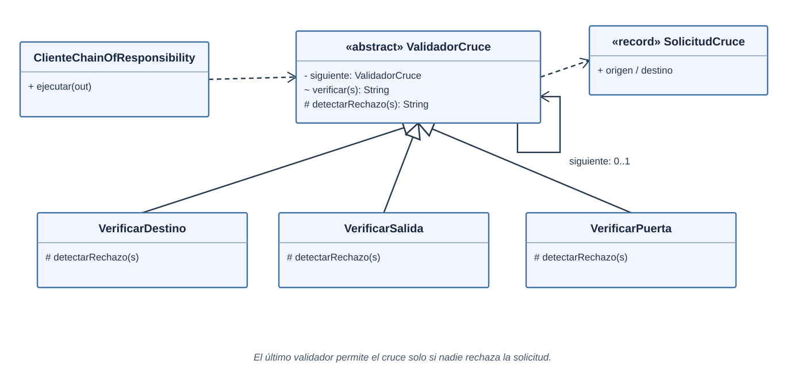

# Chain of Responsibility — ¿Se puede cruzar?

**Escena.** Frente a una puerta del pasillo amarillo, el explorador intenta pasar de H-01 a H-02. Primero se comprueba que el origen y el destino existan; después, que haya una salida dirigida y, **si existe una puerta**, que esté abierta.

**Dominio:** [R-02, R-04, R-05 y R-12](../../../DOMINIO.md). Esta demostración **valida la solicitud**; no cambia la ubicación de un explorador.

**Regla concreta:** una salida sin puerta puede atravesarse (R-04). La solicitud distingue las salidas existentes, aquellas que tienen puerta y las puertas abiertas.

**Patrón:** `ValidadorCruce` contiene una referencia a su `siguiente` validador. `VerificarDestino`, `VerificarSalida` y `VerificarPuerta` pueden **rechazar** o pasar la responsabilidad al siguiente. El cliente construye la cadena.

**Qué se aprende en Java y UML:** cada validador es un objeto distinto que hereda de la clase abstracta. Pasar una solicitud no crea ni copia sus habitaciones. La asociación con el siguiente es una referencia; no se deduce composición UML.

**Consola:**
~~~text
Puerta cerrada -> PUERTA_CERRADA
Puerta abierta -> PERMITIDO
~~~

**Pruebas:** origen o destino inexistente, salida ausente y puerta cerrada se detectan en la etapa correspondiente. Una salida sin puerta **se admite**, y se rechaza marcar como abierta una puerta que no existe. La solicitud es inmutable.

**Cuándo no usarlo:** con una única validación fija, una sola condición resulta más fácil.

[Ver código y cliente](../../../src/main/java/liminal/comportamiento/chainofresponsibility/ClienteChainOfResponsibility.java).

**Explorar los archivos por separado:** [clases Java](../../../src/main/java/liminal/comportamiento/chainofresponsibility/) · [PruebaChainOfResponsibility.java](../../../src/test/java/liminal/comportamiento/chainofresponsibility/PruebaChainOfResponsibility.java) · [guía de lectura del código](../../../GUIA_LECTURA_CODIGO.md).

## Variante para profundizar

**[Chain de validación completa](../../variantes/comportamiento/chainofresponsibility/pipeline.md):** reunir todos los fallos detectables en una solicitud, en lugar de detenerse ante el primero.
