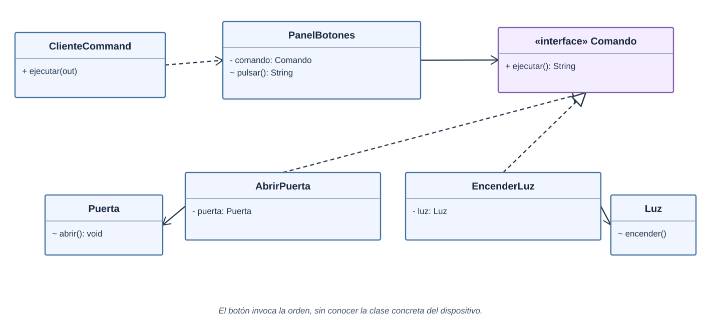

# Command — Un panel de botones

**Escena.** Un panel tiene botones configurables. Al pulsar uno se abre una puerta; al asignar otra orden, el mismo panel enciende una luz.

**Dominio:** [R-05, R-07 y R-12](../../../DOMINIO.md). El ejemplo utiliza la transición CERRADA → ABIERTA y el encendido de una luz.

**Patrón:** `Comando` declara `ejecutar()`. `AbrirPuerta` y `EncenderLuz` conservan una referencia a sus **receptores** `Puerta` y `Luz`. `PanelBotones` solo conserva una referencia al comando actual y no conoce los receptores.

**Java y UML:** la orden encapsula una llamada de método. El panel **utiliza** el comando; la orden **utiliza** el receptor. Ninguna de estas referencias exige propiedad compuesta.

**Consola:**
~~~text
Puerta P-01: ABIERTA
Luz L-01: ENCENDIDA
~~~

**Prueba:** abrir una puerta que ya está abierta falla sin modificarla; al cambiar la orden, el panel puede operar sobre una luz.

**Cuándo no usarlo:** si no hay botones configurables, historial ni acciones desacopladas, una invocación directa puede bastar.

[Ver código y cliente](../../../src/main/java/liminal/comportamiento/command/ClienteCommand.java).

**Explorar los archivos por separado:** [clases Java](../../../src/main/java/liminal/comportamiento/command/) · [PruebaCommand.java](../../../src/test/java/liminal/comportamiento/command/PruebaCommand.java) · [guía de lectura del código](../../../GUIA_LECTURA_CODIGO.md).

## Variante para profundizar

**[Command con deshacer y rehacer](../../variantes/comportamiento/command/deshacer.md):** comprobar que las transiciones inversas siguen siendo válidas y que un historial no modifica el dominio si encuentra una acción obsoleta.
