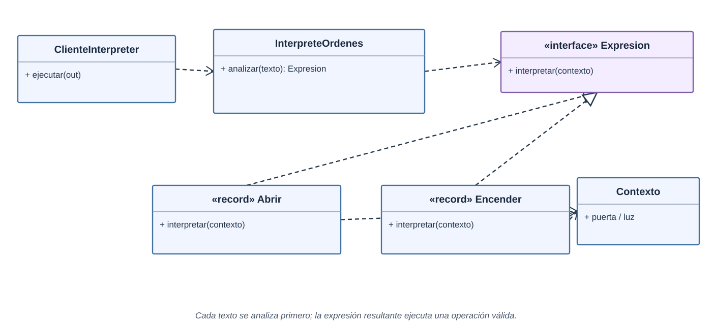

# Interpreter — Mensajes que el mundo entiende

*Referencia ambiental, no regla del mundo. Las invariantes están en [DOMINIO.md](../../../DOMINIO.md).*

**Escena.** En una terminal encuentras instrucciones mínimas: `ABRIR P-01` y `ENCENDER L-01`. No son comandos de un sistema operativo: es un **lenguaje inventado para la expedición**.

**Dominio:** R-05, R-07, R-12 y R-14. Regla local `R-LOCAL-INTERPRETER-01`: el lenguaje reconoce exclusivamente dos instrucciones de dos palabras separadas por espacios. Cada instrucción es una operación individual; no existe transacción de múltiples órdenes.

**Patrón:** `InterpreteOrdenes` analiza la cadena y produce una expresión concreta (`Abrir` o `Encender`) bajo la interfaz `Expresion`. Cada objeto expresión **interpreta** la instrucción usando `Contexto`.

**Java y UML:** el texto del usuario **no es** una clase ni una instancia. El analizador crea un objeto de tipo expresión, que al ejecutarse obtiene la puerta o luz pertinente desde el contexto. `Abrir` y `Encender` realizan `Expresion`.

**Consola:**
~~~text
Puerta P-01 ABIERTA
Luz L-01 ENCENDIDA
~~~

**Pruebas:** texto incompleto, verbo desconocido y dispositivo inexistente se rechazan sin cambiar los objetos. La gramática no acepta órdenes arbitrarias.

**Cuándo no usarlo:** una lista pequeña de comandos fija podría resolverse con un `switch`. Interpreter resulta útil para estudiar gramáticas que crecen.

[Ver código y cliente](../../../src/main/java/liminal/comportamiento/interpreter/ClienteInterpreter.java).
