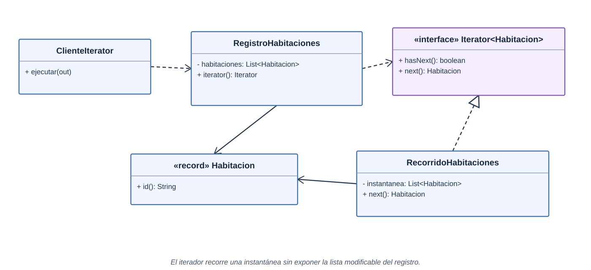

# Iterator — Recorrer habitaciones

*Referencia ambiental de esta escena. El contrato válido se define en [DOMINIO.md](../../../DOMINIO.md), no en la imagen.*

**Escena.** El explorador quiere leer todas las habitaciones de su mapa: H-01, pasillo amarillo, y H-02, piscina vacía.

**Dominio:** [R-01 y R-02](../../../DOMINIO.md). No se permite registrar dos habitaciones con el mismo ID dentro del mapa.

**Patrón:** `RegistroHabitaciones` implementa el contrato estándar de Java `Iterable<Habitacion>`. `RecorridoHabitaciones` implementa `Iterator<Habitacion>` con `hasNext()` y `next()`.

**Qué sucede en Java:** `RecorridoHabitaciones` crea **una única instantánea defensiva** de la lista que le entrega `RegistroHabitaciones`. Copia las referencias a habitaciones, no cada objeto `Habitacion`; añadir otra habitación al registro no cambia un recorrido ya iniciado. No se necesita duplicar la lista antes de llamar al constructor del iterador. En Java 21, `Iterator` e `Iterable` ya proporcionan estos contratos estándar.

**Consola:**
~~~text
H-01: Pasillo amarillo
H-02: Piscina vacía
~~~

**Pruebas:** fin de recorrido, estabilidad de la instantánea e ID repetido. Al añadir H-02 después de crear el iterador inicial, este sigue recorriendo solo H-01.

**Cuándo no usarlo:** no se recomienda implementar un iterador manual si basta con usar las colecciones e iteradores existentes.

[Ver código y cliente](../../../src/main/java/liminal/comportamiento/iterator/ClienteIterator.java).

**Explorar los archivos por separado:** [clases Java](../../../src/main/java/liminal/comportamiento/iterator/) · [PruebaIterator.java](../../../src/test/java/liminal/comportamiento/iterator/PruebaIterator.java) · [guía de lectura del código](../../../GUIA_LECTURA_CODIGO.md).

## Otras implementaciones (sin código extra)

**Instantánea frente a iterador vivo:** recorrer una copia protege el recorrido ante cambios posteriores; recorrer una colección viva puede reflejar actualizaciones o detectar modificaciones concurrentes según su contrato. No confundir detección de modificación con una garantía general de seguridad entre hilos.
