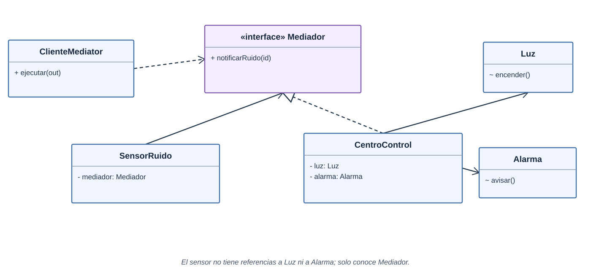

# Mediator — La central de control

**Escena.** Un sensor escucha un ruido extraño. Al detectarlo, la central enciende una luz y avisa a la alarma; el sensor no necesita conocer ninguno de esos dispositivos.

**Dominio:** [R-07, R-11 y R-12](../../../DOMINIO.md). Regla local: el ejemplo registra únicamente el sensor S-01.

**Patrón:** `Mediador` define `notificarRuido(idSensor)`. `SensorRuido` mantiene una referencia al contrato; `CentroControl` lo realiza y coordina `Luz` y `Alarma`.

**Java y UML:** la asociación sensor→mediador permite colaboración indirecta. No hay relación directa sensor→luz ni sensor→alarma. Los receptores permanecen objetos independientes.

**Consola:**
~~~text
Luz: ENCENDIDA
Avisos de alarma: 1
~~~

**Prueba:** el sensor registrado activa ambos dispositivos; un sensor desconocido se rechaza sin sumar avisos.

**Cuándo no usarlo:** una interacción de dos objetos que no va a crecer puede funcionar con una llamada directa.

[Ver código y cliente](../../../src/main/java/liminal/comportamiento/mediator/ClienteMediator.java).
