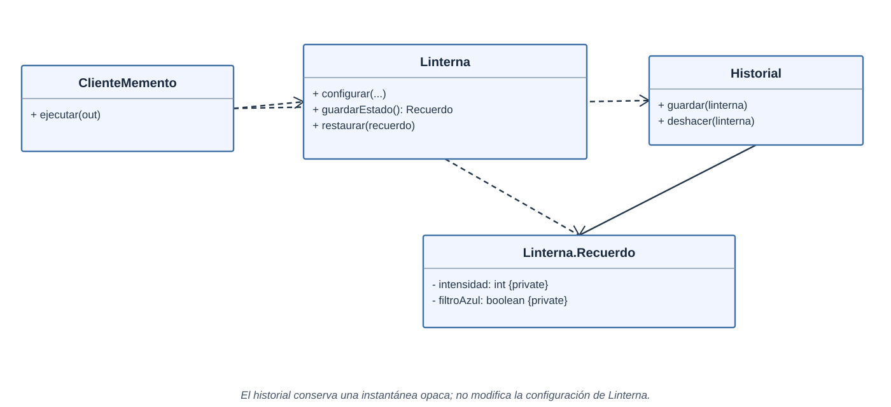

# Memento — Recordar cómo estaba la linterna

**Escena.** Una linterna empieza con intensidad 4 y sin filtro azul. Cambias la intensidad a 8 y colocas el filtro. Después restauras la configuración anterior.

**Dominio:** [R-06, R-12 y R-14](../../../DOMINIO.md). Regla local: intensidad entera entre 0 y 10; la restauración cambia **configuración**, no ubicación física del artefacto.

**Patrón:** `Linterna` (originador) crea `Recuerdo`, una clase anidada inmutable con campos privados. `Historial` (cuidador) almacena esas instantáneas y las entrega nuevamente a `Linterna` para restaurar.

**Java y UML:** el historial conserva una referencia al recuerdo, pero no conoce sus campos internos. La creación de `Recuerdo` dentro de `Linterna` no demuestra por sí sola composición UML.

**Consola:**
~~~text
Ajuste nuevo: intensidad 8, filtro azul true
Ajuste restaurado: intensidad 4, filtro azul false
~~~

**Pruebas:** se recupera el valor anterior; una intensidad inválida y deshacer sin historial se rechazan sin cambiar el estado.

**Cuándo no usarlo:** si no existe posibilidad de deshacer ni conservar instantáneas, el patrón es innecesario.

[Ver código y cliente](../../../src/main/java/liminal/comportamiento/memento/ClienteMemento.java).
