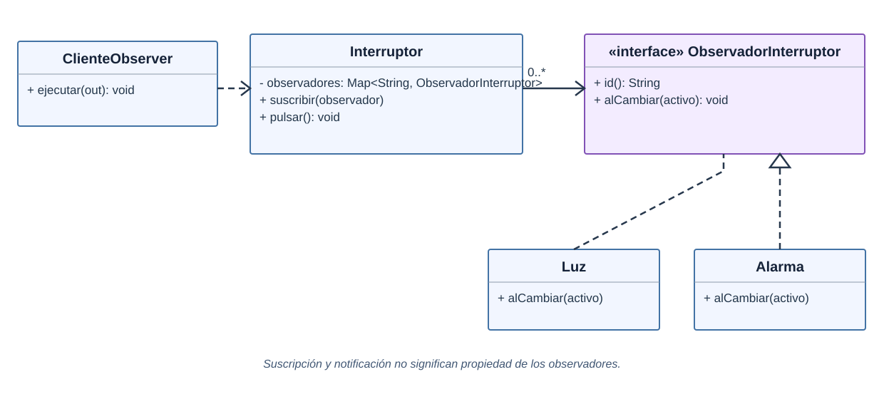
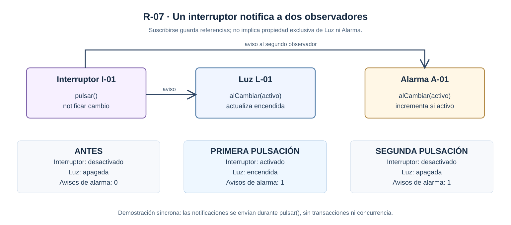

# Observer — El interruptor de la habitación

*Referencia ambiental de esta escena. El contrato válido se define en [DOMINIO.md](../../../DOMINIO.md), no en la imagen.*

**Mira las notificaciones:** el UML presenta la relación entre clases; el siguiente diagrama resume lo que reciben la luz y la alarma tras las dos pulsaciones del cliente.

**Escena.** Pulsas un interruptor en una oficina vacía. La luz se enciende y la alarma recibe un aviso. Al pulsarlo de nuevo, la luz se apaga. La alarma también puede dejar de recibir notificaciones.

**Reglas del mundo:** [R-07](../../../DOMINIO.md). Una luz está ENCENDIDA o APAGADA. Un interruptor puede notificar a varios dispositivos.

**Problema de diseño.** Un interruptor con llamadas codificadas directamente a cada tipo de luz y alarma queda acoplado a todos ellos.

**Solución GoF.** `Interruptor` mantiene un conjunto ordenado de receptores bajo el contrato `ObservadorInterruptor`. `Luz` y `Alarma` implementan ese contrato. `ClienteObserver` crea los objetos, los suscribe y pulsa el interruptor.

**Qué sucede realmente en Java:** `suscribir(luz)` guarda una **referencia** al mismo objeto `Luz`, no una copia. `pulsar()` recorre los observadores actuales e invoca `alCambiar`. Es una asociación navegable desde el interruptor, con multiplicidad `0..*`, **sin semántica de propiedad compuesta**.

**Reglas locales:** IDs de observador únicos por interruptor; al activar, `Alarma` incrementa su contador; al desactivar no lo incrementa. La demostración es síncrona y no modela concurrencia ni tolerancia a fallos entre observadores.

**Pruebas:** dos observadores reciben el cambio; duplicar un ID se rechaza sin alterar las suscripciones; al retirar la alarma ya no recibe avisos.

**Salida de consola prevista:**

~~~text
Pulsar -> ENCENDIDO
Luz -> ENCENDIDA
Avisos de alarma -> 1
Volver a pulsar -> APAGADO
Luz -> APAGADA
~~~

**Alternativa legítima:** con un solo dispositivo y una colaboración fija puede bastar una llamada directa. Observer aporta valor cuando cambian los receptores y sus suscripciones.

**Archivos:** [ClienteObserver.java](../../../src/main/java/liminal/comportamiento/observer/ClienteObserver.java) · [PruebaObserver.java](../../../src/test/java/liminal/comportamiento/observer/PruebaObserver.java).
