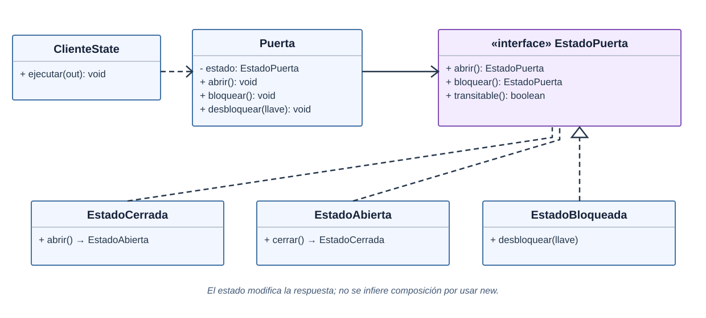
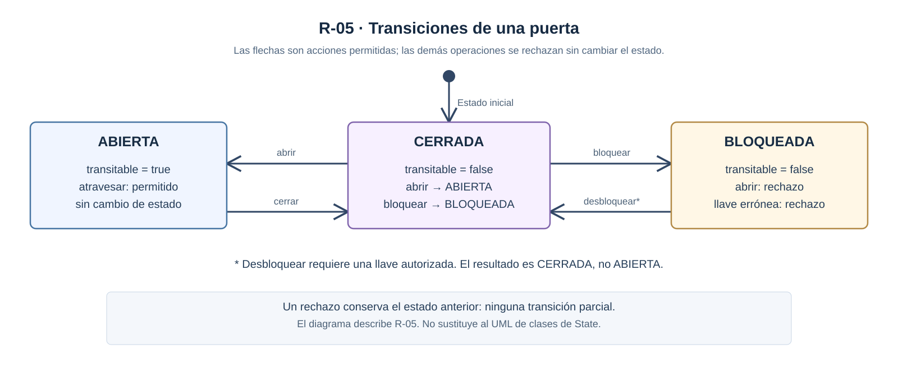

# State — La puerta bloqueada

*Referencia ambiental de esta escena. El contrato válido se define en [DOMINIO.md](../../../DOMINIO.md), no en la imagen.*

**Dos maneras de leer el diseño:** el UML anterior responde «¿qué clases colaboran?»; el siguiente diagrama responde «¿qué transiciones permite R-05?».

**Escena.** En un pasillo amarillo encuentras una puerta cerrada. Al bloquearla, intentar abrirla no sirve. Con la llave correcta vuelves al estado cerrado; entonces puedes abrirla y atravesarla.

**Reglas del mundo:** [R-05 y R-12](../../../DOMINIO.md). No inventamos transiciones para que encajen con el patrón: primero existe el contrato de la puerta.

| Estado actual | Acción | Resultado |
| --- | --- | --- |
| CERRADA | abrir | ABIERTA |
| CERRADA | bloquear | BLOQUEADA |
| BLOQUEADA | desbloquear con llave correcta | CERRADA |
| BLOQUEADA | abrir o usar llave incorrecta | Rechazo; sigue BLOQUEADA |
| ABIERTA | cerrar | CERRADA |

**Problema de diseño.** Si las acciones crecen, un conjunto de `if` o `switch` repartidos por `Puerta` dificulta mantener las transiciones.

**Solución GoF.** `Puerta` es el *contexto*. Conserva una **referencia** a un objeto que implementa `EstadoPuerta` y le delega cada operación. `EstadoCerrada`, `EstadoAbierta` y `EstadoBloqueada` representan los comportamientos. La clase cliente es `ClienteState`.

**Qué sucede realmente en Java:** `new EstadoCerrada()` crea un objeto; `Puerta.estado` conserva su referencia. Al ejecutar `puerta.abrir()`, el contexto llama al método del estado y recibe el próximo estado. Esto muestra una asociación hacia `EstadoPuerta`, pero **no demuestra composición** por el hecho de usar `new`.

**Prueba:** la puerta bloqueada no se abre; una llave errónea tampoco la desbloquea; ambas operaciones dejan intacto el estado. El recorrido válido sí llega a ABIERTA.

**Salida de consola prevista:**

~~~text
Puerta P-01: CERRADA
Bloquear -> BLOQUEADA
Abrir bloqueada -> denegado
Desbloquear -> CERRADA
Abrir -> ABIERTA
¿Se puede pasar? Sí
~~~

**Alternativa legítima:** un `enum` y pocos métodos pueden ser suficientes si hay tres estados estables y pocas transiciones. State cobra sentido cuando aumenta el comportamiento específico de cada estado.

**Archivos:** [ClienteState.java](../../../src/main/java/liminal/comportamiento/state/ClienteState.java) · [PruebaState.java](../../../src/test/java/liminal/comportamiento/state/PruebaState.java).

**Ejecutar:** desde la raíz del repositorio, compilar con el script de la colección y ejecutar `java -cp colecciones/liminal/out liminal.DemoLiminal state`.
