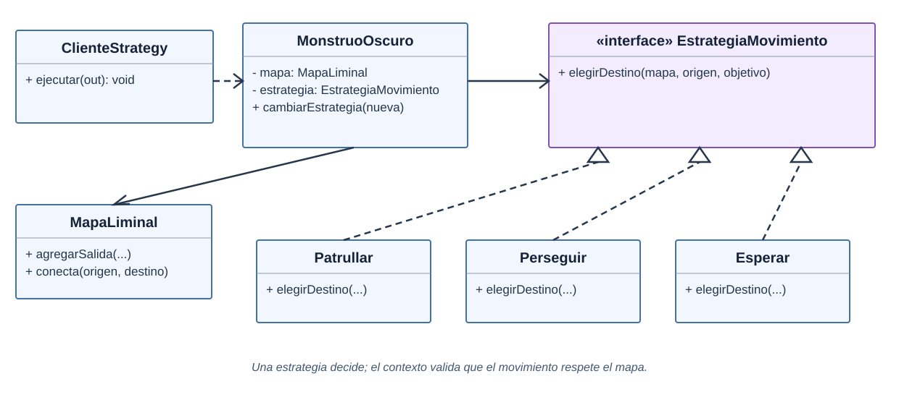

# Strategy — El monstruo oscuro cambia de movimiento

**Escena.** En una zona con pasillo amarillo y piscina vacía aparece un monstruo oscuro. Primero patrulla por una salida; después persigue un objetivo que está en una habitación vecina; finalmente permanece quieto.

**Reglas del mundo:** [R-02, R-08 y R-12](../../../DOMINIO.md). El mapa contiene salidas dirigidas identificadas. Una estrategia puede **proponer** el siguiente destino, pero no saltarse las conexiones del mapa.

**Problema de diseño.** Si el movimiento de cada criatura se implementa con condicionales repetidos, variar entre patrullar, perseguir y esperar requiere modificar muchas clases.

**Solución GoF.** `MonstruoOscuro` es el *contexto* y conserva una **asociación** con `EstrategiaMovimiento`. `Patrullar`, `Perseguir` y `Esperar` implementan el contrato. `ClienteStrategy` decide qué estrategia probar.

**Qué sucede realmente en Java:** el monstruo se crea **una sola vez**. `cambiarEstrategia(new Perseguir())` sustituye una referencia a la estrategia, **no** crea otro monstruo. `avanzar()` valida que el destino exista y que sea la misma habitación o una salida directa.

**Reglas locales del ejemplo:** la patrulla escoge la **primera salida registrada**, la persecución solo avanza si el objetivo es adyacente y la espera conserva la posición. Estas decisiones no son leyes universales de Backrooms ni son requisitos del patrón Strategy.

**Pruebas:** tras cambiar de estrategia, el monstruo conserva identidad; no puede llegar a una habitación inexistente; tampoco puede aceptar un destino no conectado propuesto por una implementación defectuosa.

**Salida de consola prevista:**

~~~text
Monstruo oscuro: Pasillo amarillo
Patrullar -> Piscina vacía
Perseguir -> Pasillo amarillo
Esperar -> Pasillo amarillo
~~~

**Alternativa legítima:** una única política de movimiento no requiere Strategy. Tiene valor cuando deben intercambiarse algoritmos sin duplicar el contexto.

**Archivos:** [ClienteStrategy.java](../../../src/main/java/liminal/comportamiento/strategy/ClienteStrategy.java) · [PruebaStrategy.java](../../../src/test/java/liminal/comportamiento/strategy/PruebaStrategy.java).
