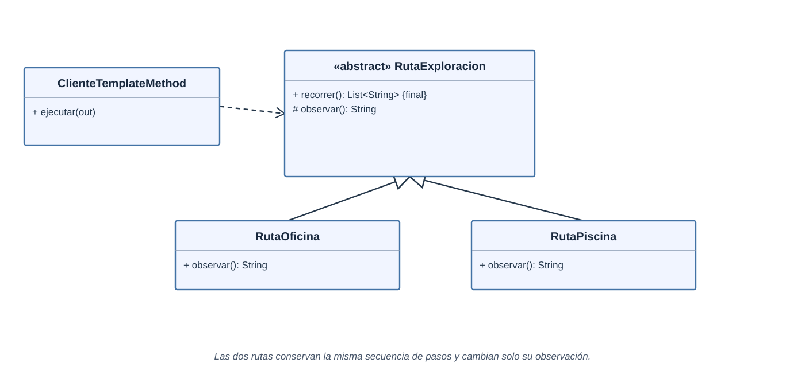

# Template Method — Dos excursiones diferentes

**Escena.** Un explorador recorre una oficina vacía; otro observa una piscina abandonada. Ambos preparan su linterna antes y regresan a un punto seguro al finalizar.

**Dominio:** [R-11, R-13 y R-14](../../../DOMINIO.md). Cambiar la ambientación no altera las reglas generales del mundo.

**Patrón:** `RutaExploracion` define un método final `recorrer()` con los pasos `preparar()`, `observar()` y `finalizar()`. `RutaOficina` y `RutaPiscina` redefinen únicamente la observación.

**Java y UML:** las rutas concretas **heredan** de la clase abstracta. No hay necesidad de asociaciones ni rombos adicionales para explicar este patrón.

**Consola:**
~~~text
Preparar linterna -> Observar oficina vacía -> Regresar al punto seguro
Preparar linterna -> Observar piscina vacía -> Regresar al punto seguro
~~~

**Prueba:** orden inicial y final idéntico en ambas rutas; paso central diferente.

**Cuándo no usarlo:** cuando las secuencias no comparten pasos o cuando se prefieren algoritmos intercambiables en tiempo de ejecución, evaluar Strategy.

[Ver código y cliente](../../../src/main/java/liminal/comportamiento/templatemethod/ClienteTemplateMethod.java).
