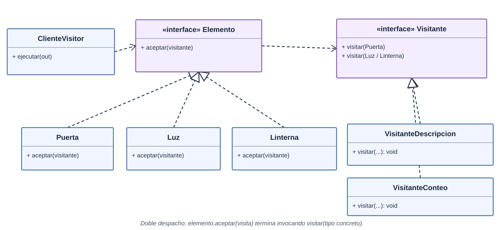

# Visitor — El inspector describe lo que encuentra

**Escena.** Una expedición contiene una puerta, una luz y una linterna. Un inspector los **describe** y otro cuenta cuántos objetos se visitaron.

**Dominio:** [R-07 y R-14](../../../DOMINIO.md). La visita es una consulta; no cambia la ubicación ni el estado de los objetos.

**Patrón:** `Elemento` define `aceptar(Visitante)`. `Puerta`, `Luz` y `Linterna` realizan el contrato, y cada uno llama a `visitante.visitar(this)`. `VisitanteDescripcion` y `VisitanteConteo` implementan operaciones diferentes.

**Java y UML:** la llamada `aceptar` selecciona el método `visitar` según el **tipo concreto del elemento**; esto es doble despacho. Los visitantes reciben referencias, no copias. El diagrama enfatiza las dos interfaces y sus realizaciones.

**Consola:**
~~~text
PUERTA P-01
LUZ L-01
LINTERNA A-01
~~~

**Prueba:** dos visitantes procesan los tres tipos; uno produce las descripciones y el otro cuenta tres objetos.

**Cuándo no usarlo:** si cambian continuamente los tipos de elementos, añadir métodos a cada visitante se vuelve costoso.

[Ver código y cliente](../../../src/main/java/liminal/comportamiento/visitor/ClienteVisitor.java).
