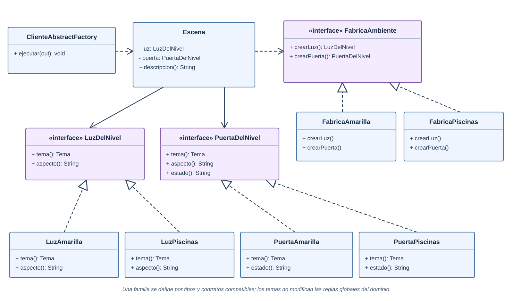

# Abstract Factory — Dos ambientes liminales

*Referencia ambiental de esta escena. El contrato válido se define en [DOMINIO.md](../../../DOMINIO.md), no en la imagen.*

**Escena:** al preparar un pasillo amarillo aparecen una luz fluorescente amarilla y una puerta beige. En las piscinas vacías aparecen un reflejo azul y una puerta blanca.

**Dominio:** [R-05, R-13 y R-14](../../../DOMINIO.md). El cambio de estética **no cambia las reglas universales de las puertas**; en este ejemplo sus representaciones comienzan CERRADAS.

**Problema:** mezclar luces del tema amarillo con puertas de piscinas puede romper la coherencia visual de una escena.

**Patrón:** `FabricaAmbiente` declara cómo crear `LuzDelNivel` y `PuertaDelNivel`. `FabricaAmarilla` fabrica `LuzAmarilla` y `PuertaAmarilla`; `FabricaPiscinas` fabrica `LuzPiscinas` y `PuertaPiscinas`. Son **cuatro clases concretas diferentes** que cumplen dos contratos comunes.

**Java y UML:** `Escena` solicita los productos a través de la **interfaz de fábrica** y guarda referencias a los **contratos de producto**: no necesita conocer las cuatro clases concretas. El `Tema` sirve para validar la coherencia de la escena. La fábrica elige la familia; usar `new` y guardar atributos no demuestra propiedad compuesta en UML.

**Distinción frente a Factory Method:** aquí la fábrica proporciona **dos productos relacionados**, no un único método de creación especializado en una subclase.

**Resultado de consola:**

~~~text
AMARILLO: fluorescente amarilla y puerta beige
PISCINAS: reflejo azul y puerta blanca
~~~

**Prueba:** se verifican tanto los **tipos concretos** de luz y puerta como su `Tema`. Una escena mezclada se rechaza, incluso cuando una fábrica defectuosa devuelve productos de familias distintas.

**Cuándo no usarlo:** si solo hay un objeto que construir, puede bastar Factory Method o un constructor.

[Ver código y clase cliente](../../../src/main/java/liminal/creacionales/abstractfactory/ClienteAbstractFactory.java).

**Explorar los archivos por separado:** [clases Java](../../../src/main/java/liminal/creacionales/abstractfactory/) · [PruebaAbstractFactory.java](../../../src/test/java/liminal/creacionales/abstractfactory/PruebaAbstractFactory.java) · [guía de lectura del código](../../../GUIA_LECTURA_CODIGO.md).
