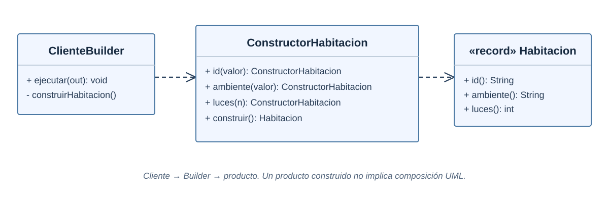

# Builder — Construir una habitación paso a paso

*Referencia ambiental de esta escena. El contrato válido se define en [DOMINIO.md](../../../DOMINIO.md), no en la imagen.*

**Escena:** preparas una habitación del pasillo amarillo con cuatro luces y una puerta. Primero seleccionas el ID, después el ambiente, las luces y la existencia de una puerta.

**Dominio:** [R-01, R-12 y R-13](../../../DOMINIO.md). `R-LOCAL-BUILDER-01`: una habitación creada en esta demo declara un ambiente, un ID y una cantidad de luces no negativa. El mapa rechaza habitaciones con el mismo ID.

**Problema:** constructores con muchos parámetros posicionales son difíciles de leer cuando se describen ambientes visuales.

**Patrón:** `ConstructorHabitacion` guarda temporalmente los valores y produce un objeto `Habitacion` validado en `construir()`. **Builder necesita esencialmente dos roles:** producto y constructor paso a paso. `RegistroHabitaciones` es un colaborador del dominio para IDs únicos, **no otro participante GoF obligatorio**.

**Dónde está cada tipo en GitHub:** ahora cada uno tiene un archivo independiente:

- [`ClienteBuilder.java`](../../../src/main/java/liminal/creacionales/builder/ClienteBuilder.java) — indica el recorrido con los métodos `construirHabitacion()`, `registrarHabitacion()` y `mostrarHabitacion()`.
- [`ConstructorHabitacion.java`](../../../src/main/java/liminal/creacionales/builder/ConstructorHabitacion.java) — configura paso a paso.
- [`Habitacion.java`](../../../src/main/java/liminal/creacionales/builder/Habitacion.java) — producto inmutable.
- [`RegistroHabitaciones.java`](../../../src/main/java/liminal/creacionales/builder/RegistroHabitaciones.java) — comprobación de identidad del mapa.
- [`PruebaBuilder.java`](../../../src/test/java/liminal/creacionales/builder/PruebaBuilder.java) — pruebas separadas del cliente.

**Java y UML:** el constructor y el producto son **objetos distintos**. El hecho de crear un objeto en `construir()` no prueba por sí solo propiedad compuesta. La construcción del objeto y su inscripción en el mapa son responsabilidades separadas.

**Resultado de consola:**

~~~text
Habitación: H-01
Ambiente: Pasillo amarillo
Luces: 4
Puerta: sí
~~~

**Prueba:** faltas de configuración, luces negativas e IDs repetidos se rechazan sin dejar una habitación registrada incorrectamente.

**Cuándo no usarlo:** para un `record` de dos campos obligatorios, su constructor puede ser suficiente.

[Abrir la carpeta con todas las clases](../../../src/main/java/liminal/creacionales/builder/).
