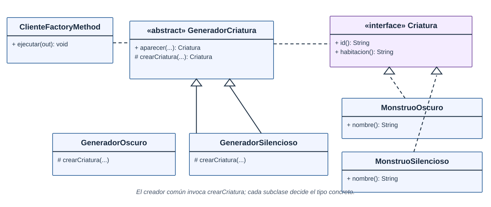

# Factory Method — Una aparición en el pasillo

**Escena:** en dos habitaciones aparecen un **monstruo oscuro** y un **monstruo silencioso**. El controlador común registra cada aparición; los generadores concretos deciden qué criatura construir.

**Dominio:** [R-01, R-08, R-12 y R-14](../../../DOMINIO.md). Regla local: `R-LOCAL-FACTORYMETHOD-01` permite dos tipos sencillos de criatura. Cada una debe tener un ID único y una habitación reconocida por el registro.

**Problema:** duplicar la lógica de registrar y validar IDs cada vez que aparece un tipo nuevo dificulta mantener las reglas.

**Patrón:** `GeneradorCriatura` define `aparecer(...)`, que valida el registro y llama al **factory method** abstracto `crearCriatura(...)`. `GeneradorOscuro` y `GeneradorSilencioso` eligen sus productos.

**Java y UML:** las fábricas concretas **heredan** del creador; los monstruos concretos **realizan** la interfaz `Criatura`. El cliente recibe productos por su contrato, no por el conocimiento de su constructor concreto.

**Resultado de consola:**

~~~text
Monstruo oscuro en H-01
Monstruo silencioso en H-02
~~~

**Prueba:** se crea el tipo correcto; IDs duplicados y habitaciones inexistentes se rechazan antes de mutar el registro.

**Cuándo no usarlo:** si una condición local basta y nunca se extiende la creación, una función simple puede ser más legible.

[Ver código y clase cliente](../../../src/main/java/liminal/creacionales/factorymethod/ClienteFactoryMethod.java).

**Explorar los archivos por separado:** [clases Java](../../../src/main/java/liminal/creacionales/factorymethod/) · [PruebaFactoryMethod.java](../../../src/test/java/liminal/creacionales/factorymethod/PruebaFactoryMethod.java) · [guía de lectura del código](../../../GUIA_LECTURA_CODIGO.md).

## Otras implementaciones (sin código extra)

**Método de fábrica virtual frente a fábrica parametrizada:** una fábrica estática con un switch puede crear criaturas, pero no reproduce el punto de extensión por herencia de Factory Method GoF. Escoger la variante depende de si realmente necesitamos creadores intercambiables.
