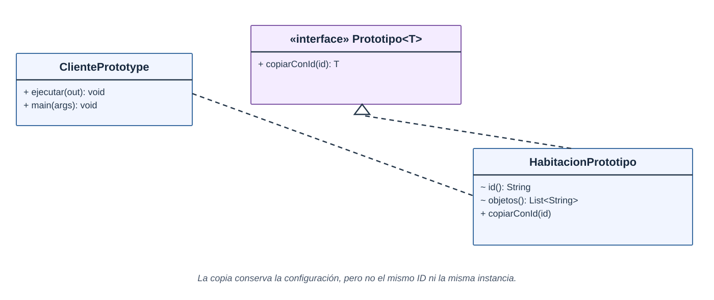

# Prototype — Copiar el diseño de una habitación

*Referencia ambiental de esta escena. El contrato válido se define en [DOMINIO.md](../../../DOMINIO.md), no en la imagen.*

**Escena:** hay un pasillo amarillo con una linterna y una llave. Necesitamos otra habitación con la misma **plantilla de objetos**, pero con identidad H-02 en lugar de H-01.

**Dominio:** [R-01 y R-10](../../../DOMINIO.md). La copia no puede reutilizar el ID del original. Los objetos de la lista representan **nombres de plantilla**, no instancias físicas duplicadas de linternas; las copias reales de artefactos obedecerían R-06.

**Problema:** recrear una configuración extensa de habitación puede repetir parámetros y provocar divergencias.

**Patrón:** `Prototipo<T>` declara `copiarConId(...)`; `HabitacionPrototipo` realiza el contrato y crea un nuevo objeto con configuración igual e ID distinto.

**Java y UML:** `original == copia` es `false`, aunque las listas de cadenas tengan contenido igual. La lista es inmutable; su almacenamiento compartido, si lo optimiza Java, no rompería el modelo.

**Resultado de consola:**

~~~text
Original: H-01
Copia: H-02
Mismos objetos de plantilla: true
¿Misma instancia? false
~~~

**Prueba:** IDs diferentes, configuración equivalente, rechazo de ID original y protección frente a mutaciones de una lista externa.

**Cuándo no usarlo:** si la configuración consta de uno o dos valores, crear directamente el objeto puede ser más simple.

[Ver código y clase cliente](../../../src/main/java/liminal/creacionales/prototype/ClientePrototype.java).

**Explorar los archivos por separado:** [clases Java](../../../src/main/java/liminal/creacionales/prototype/) · [PruebaPrototype.java](../../../src/test/java/liminal/creacionales/prototype/PruebaPrototype.java) · [guía de lectura del código](../../../GUIA_LECTURA_CODIGO.md).
