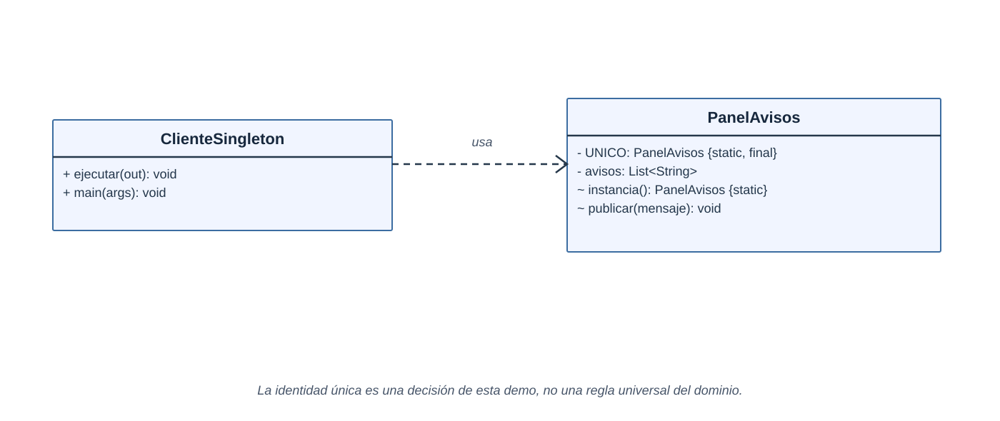

# Singleton — El panel de avisos de la expedición

**Escena:** en un pasillo vacío aparecen avisos sobre una puerta y un ruido extraño. Dos referencias del programa consultan el **mismo panel** de esa demostración.

**Dominio:** reglas [R-11 y R-14](../../../DOMINIO.md). No existe una regla universal de Backrooms que obligue a que haya un único panel de avisos: **esta unicidad pertenece a la demostración**.

**Problema:** si una demo necesita un panel compartido, crear uno en cada clase fragmentaría el historial.

**Patrón:** `PanelAvisos` tiene constructor privado, instancia estática única y método `instancia()`. `ClienteSingleton` obtiene dos referencias y comprueba `a == b`.

**Java y UML:** una referencia no es una copia. Una llamada estática no necesita ejecutar `new` en el cliente; se dibuja una **dependencia** desde el cliente hacia `PanelAvisos`, no una composición.

**Resultado de consola:**

~~~text
¿Es el mismo panel? true
Avisos: 2
Último aviso: Se escucha un ruido
~~~

**Prueba:** dos consultas recuperan la misma instancia, se comparte el historial y se rechazan mensajes vacíos sin mutarlo.

**Cuándo no usarlo:** cuando el panel deba ser distinto por jugador, partida o ejecución, conviene una instancia administrada por su propietario. Singleton tiene costos de estado global y testeo.

[Ver código y clase cliente](../../../src/main/java/liminal/creacionales/singleton/ClienteSingleton.java).

**Explorar los archivos por separado:** [clases Java](../../../src/main/java/liminal/creacionales/singleton/) · [PruebaSingleton.java](../../../src/test/java/liminal/creacionales/singleton/PruebaSingleton.java) · [guía de lectura del código](../../../GUIA_LECTURA_CODIGO.md).
