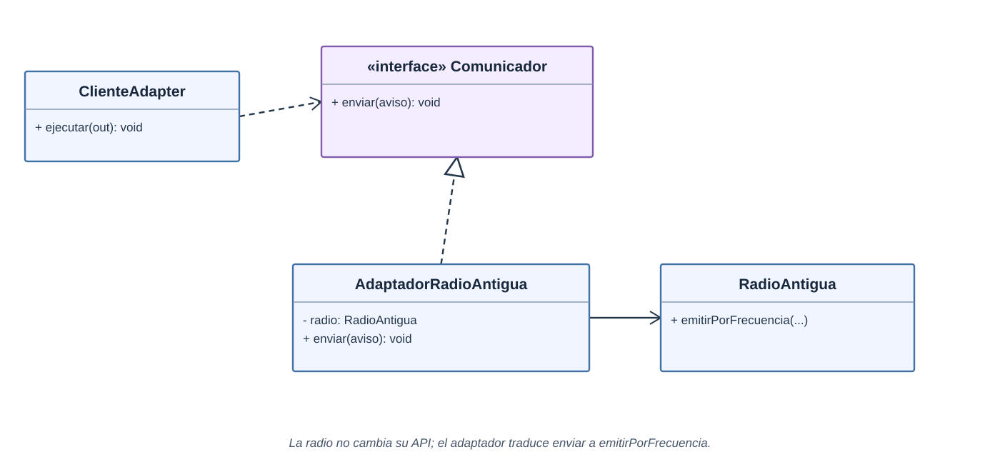

# Adapter — Una radio que habla un idioma antiguo

**Escena:** en una oficina vacía encuentras una radio antigua que solo entiende `emitirPorFrecuencia`. Los exploradores usan la operación simple `enviar`.

**Dominio:** R-07 y R-14 del [contrato](../../../DOMINIO.md). Las emisiones son textos **simulados**, no tráfico de red ni llamadas reales.

**Problema:** el cliente necesita otro contrato y no queremos cambiar la radio antigua. **Adapter** introduce `Comunicador` y `AdaptadorRadioAntigua`, que recibe una **referencia** a `RadioAntigua` y traduce las llamadas.

**Qué sucede en Java:** `new RadioAntigua()` crea el aparato, `new AdaptadorRadioAntigua(radio)` crea otro objeto que lo **utiliza**. El adaptador realiza `Comunicador` y se asocia con `RadioAntigua`; esta referencia no demuestra propiedad compuesta.

**Consola:** `Radio antigua: Explorador en H-01`.

**Pruebas:** el mensaje llega al aparato y un mensaje vacío se rechaza sin reemplazar el último aviso.

**Alternativa:** si las dos interfaces ya coinciden, no se necesita adaptador.

[Ver cliente y código](../../../src/main/java/liminal/estructurales/adapter/ClienteAdapter.java).

**Explorar los archivos por separado:** [clases Java](../../../src/main/java/liminal/estructurales/adapter/) · [PruebaAdapter.java](../../../src/test/java/liminal/estructurales/adapter/PruebaAdapter.java) · [guía de lectura del código](../../../GUIA_LECTURA_CODIGO.md).
