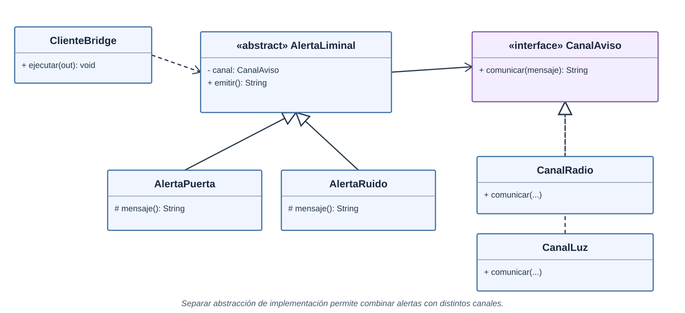

# Bridge — Un aviso que puede viajar por luz o radio

**Escena:** un aviso de puerta bloqueada se transmite por radio; otro aviso sobre un ruido aparece como señal luminosa.

**Dominio:** R-07, R-11, R-14. Son mensajes discretos de una demostración, sin radiofrecuencia real.

**Problema:** codificar todas las combinaciones `AlertaPuertaPorRadio`, `AlertaPuertaPorLuz`, `AlertaRuidoPorRadio`, etc., hace crecer las clases sin necesidad.

**Patrón:** `AlertaLiminal` es la **abstracción**, y su atributo `canal: CanalAviso` es el puente a la implementación. `AlertaPuerta` y `AlertaRuido` varían el contenido; `CanalRadio` y `CanalLuz` varían el medio.

**Java/UML:** la alerta **conserva una referencia** a una interfaz, no crea ni posee necesariamente un canal. La abstracción hereda en las alertas concretas; los canales realizan `CanalAviso`.

**Consola:** `Radio: puerta bloqueada` y `Luz: ruido en el pasillo`.

**Pruebas:** el mismo aviso funciona con ambos canales y un mismo canal transmite diferentes tipos de aviso.

**Alternativa:** si solo hay una combinación fija, un método directo basta.

[Ver cliente y código](../../../src/main/java/liminal/estructurales/bridge/ClienteBridge.java).

**Explorar los archivos por separado:** [clases Java](../../../src/main/java/liminal/estructurales/bridge/) · [PruebaBridge.java](../../../src/test/java/liminal/estructurales/bridge/PruebaBridge.java) · [guía de lectura del código](../../../GUIA_LECTURA_CODIGO.md).
