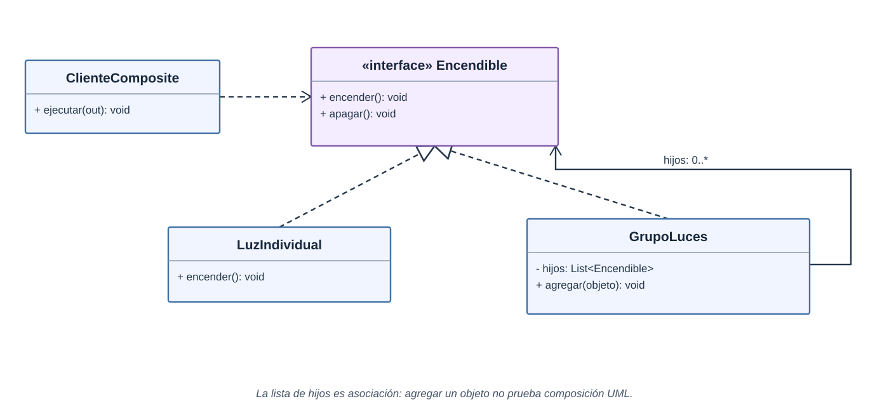

# Composite — Encender un grupo de luces

**Escena:** en un pasillo amarillo hay dos luces. Con la misma orden podemos encender **una luz** o **todo el grupo**, incluso si un grupo contiene otro grupo.

**Dominio:** R-07, R-12 y R-14. Regla local: `R-LOCAL-COMPOSITE-01`, los grupos forman una estructura **sin ciclos**; una referencia repetida en el mismo grupo se rechaza.

**Patrón:** tanto `LuzIndividual` (*hoja*) como `GrupoLuces` (*compuesto*) realizan la interfaz `Encendible`. El grupo llama a `encender()` o `apagar()` de cada elemento.

**Java y UML:** `List<Encendible>` contiene **referencias**; su presencia no demuestra composición UML con rombo negro. Este ejemplo representa una **asociación de agrupación**, y no declara propiedad exclusiva de las luces. El nombre del patrón **Composite** tampoco equivale automáticamente a la relación UML «composición».

**Consola:** `Luz L-01: ENCENDIDA` y `Luz L-02: ENCENDIDA`.

**Pruebas:** encender/apagar grupos anidados y rechazar ciclos sin mutar el grupo.

**Alternativa:** si siempre hay dos luces fijas, llamarlas directamente es más sencillo.

[Ver cliente y código](../../../src/main/java/liminal/estructurales/composite/ClienteComposite.java).
