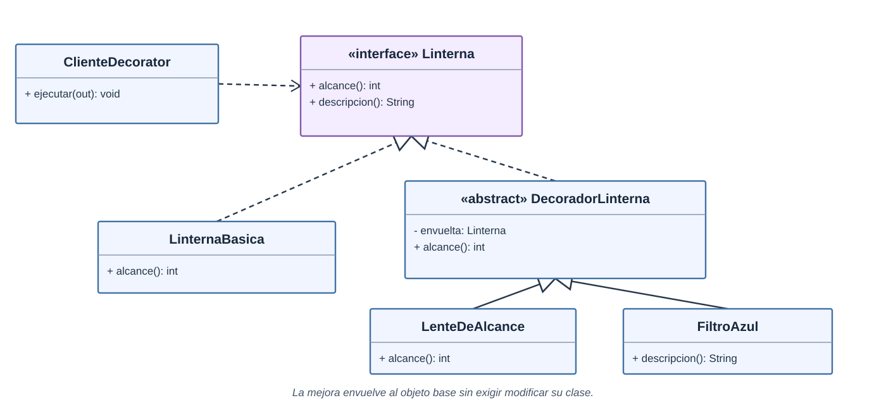

# Decorator — Una linterna con mejoras

**Escena:** encuentras una linterna sencilla de cinco metros de alcance. Le colocas una lente que suma tres metros y después un filtro azul.

**Dominio:** R-06, R-12 y R-14. Aquí configuramos sus **propiedades**, sin representar que se encuentre físicamente en dos inventarios.

**Problema:** crear subclases para cada combinación `LinternaConLenteYFiltro`, `LinternaConFiltro`, etc., multiplica variantes.

**Patrón:** `LinternaBasica` y `DecoradorLinterna` realizan el contrato `Linterna`. `LenteDeAlcance` y `FiltroAzul` son decoradores concretos; reciben la linterna anterior y añaden comportamiento.

**Java y UML:** una mejora **envuelve por referencia** a la linterna anterior. No la copia; tampoco el uso de `new` en el cliente prueba composición UML. `base.alcance()` sigue dando 5 mientras `mejorada.alcance()` da 8.

**Consola:** `Base: linterna básica (5 m)` y `Mejorada: linterna básica con lente y filtro azul (8 m)`.

**Pruebas:** el comportamiento añadido no muta la base y se rechaza una mejora negativa.

**Alternativa:** una linterna fija con propiedades simples no necesita múltiples decoradores.

[Ver cliente y código](../../../src/main/java/liminal/estructurales/decorator/ClienteDecorator.java).

**Explorar los archivos por separado:** [clases Java](../../../src/main/java/liminal/estructurales/decorator/) · [PruebaDecorator.java](../../../src/test/java/liminal/estructurales/decorator/PruebaDecorator.java) · [guía de lectura del código](../../../GUIA_LECTURA_CODIGO.md).

## Otras implementaciones (sin código extra)

**Orden y selección de decoradores:** dos mejoras pueden no conmutar si modifican el mismo valor. Una decoración condicional tiene sentido cuando la combinación cambia por configuración; no se necesita un administrador de plugins para dos mejoras fijas.
