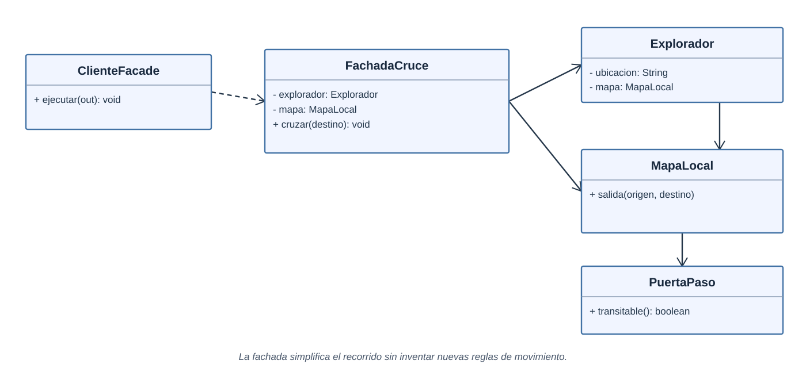

# Facade — Atravesar un pasillo con seguridad

*Referencia ambiental de esta escena. El contrato válido se define en [DOMINIO.md](../../../DOMINIO.md), no en la imagen.*

**Escena:** un explorador desea pasar de H-01 a H-02. Para ello debe comprobar que ambas habitaciones existen, que hay una **salida dirigida** y que su puerta está abierta.

**Dominio:** R-02, R-03, R-04, R-05 y R-12. Un movimiento rechazado **no cambia** la habitación actual.

**Problema:** si cada cliente repite las validaciones del mapa, puerta y explorador, es fácil olvidar una condición.

**Patrón:** `FachadaCruce` ofrece `cruzar(destino)` y coordina `Explorador` y `MapaLocal`. La fachada no añade excepciones al dominio ni teletransportación.

**Java y UML:** la fachada guarda referencias a objetos que **utiliza** para verificar el cruce; son asociaciones, no una relación de propiedad compuesta. El método solo actualiza la ubicación **al final** de todas las comprobaciones.

**Consola:** `Inicio: H-01` seguido de `Cruce correcto: H-02`.

**Pruebas:** puerta cerrada, destino inexistente y ausencia de salida de regreso son rechazos; el cruce válido funciona.

**Alternativa:** con un solo método sin coordinación adicional, la fachada puede ser innecesaria.

[Ver cliente y código](../../../src/main/java/liminal/estructurales/facade/ClienteFacade.java).
