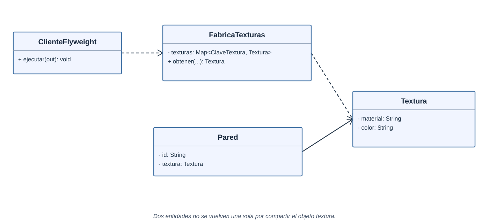

# Flyweight — Varias paredes, una misma textura

*Referencia ambiental de esta escena. El contrato válido se define en [DOMINIO.md](../../../DOMINIO.md), no en la imagen.*

**Escena:** un pasillo amarillo tiene muchas paredes que muestran **el mismo patrón de papel tapiz**. Cada pared tiene su identidad, pero la información inmutable de la textura se reutiliza.

**Dominio:** R-01, R-10, R-13. Regla local: `R-LOCAL-FLYWEIGHT-01`, una textura se define por material y color; las paredes no son copias unas de otras.

**Problema:** repetir una configuración idéntica de textura en cada pared desperdicia objetos compartibles.

**Patrón:** `FabricaTexturas` conserva un mapa de `ClaveTextura` a `Textura`; dos solicitudes equivalentes devuelven **la misma instancia inmutable**. `Pared` conserva una referencia a ella.

**Java y UML:** `pared1 != pared2` mientras `pared1.textura() == pared2.textura()`. Compartir un *flyweight* no significa que las dos paredes sean la misma entidad ni que alguna sea propietaria exclusiva de la textura.

**Consola:** `Paredes distintas: true`, `Textura compartida: true`, `Texturas almacenadas: 1`.

**Pruebas:** configuración igual reutiliza la textura; otra configuración crea otra; texto inválido no altera la fábrica.

**Alternativa:** pocas texturas pequeñas no siempre justifican la fábrica y su caché.

[Ver cliente y código](../../../src/main/java/liminal/estructurales/flyweight/ClienteFlyweight.java).
