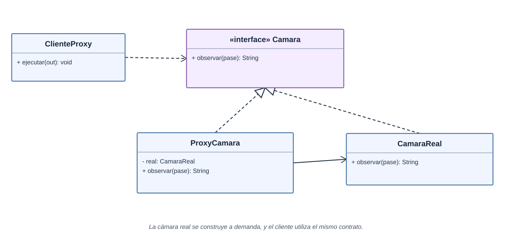

# Proxy — Cámara con acceso controlado

*Referencia ambiental de esta escena. El contrato válido se define en [DOMINIO.md](../../../DOMINIO.md), no en la imagen.*

**Escena:** una cámara ficticia muestra un pasillo. Antes de visualizarlo, hay que introducir un pase; sin pase, el monitor responde «denegado».

**Dominio:** R-07, R-11, R-12 y R-14. La cámara no accede a una red real ni recopila datos personales. El pase es una regla **local de la demo**, no del mundo completo.

**Problema:** necesitamos controlar el acceso y evitar construir la cámara real cuando todavía no es necesaria.

**Patrón:** `ProxyCamara` y `CamaraReal` realizan el contrato `Camara`. El cliente solo conoce esa interfaz. El proxy valida el pase y construye el objeto real de forma **perezosa** la primera vez que se necesita.

**Java y UML:** crear `ProxyCamara` no crea aún `CamaraReal`. Un acceso sin permiso no la crea. La asociación proxy→real se establece cuando se autoriza una consulta.

**Consola:** `Cámara real creada al inicio: 0`, `Acceso sin pase: denegado`, `Vista: Pasillo amarillo` y `Cámara real creada al final: 1`.

**Pruebas:** acceso denegado sin instanciar; acceso autorizado delega; solicitudes repetidas reutilizan la cámara.

**Alternativa:** sin control ni carga diferida, utilizar directamente la cámara sería suficiente.

[Ver cliente y código](../../../src/main/java/liminal/estructurales/proxy/ClienteProxy.java).

**Explorar los archivos por separado:** [clases Java](../../../src/main/java/liminal/estructurales/proxy/) · [PruebaProxy.java](../../../src/test/java/liminal/estructurales/proxy/PruebaProxy.java) · [guía de lectura del código](../../../GUIA_LECTURA_CODIGO.md).

## Variante para profundizar

**[Proxy con caché e invalidación](../../variantes/estructurales/proxy/cache.md):** reutilizar una vista costosa y regenerarla cuando cambia la revisión de una escena, sin red real ni relojes.
