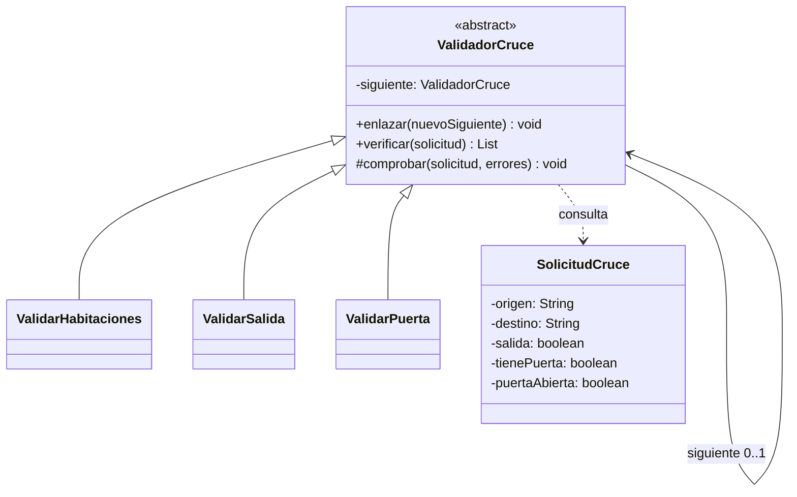

# Chain of Responsibility: reportar todos los fallos


Primero lee [Chain of Responsibility clásico](../../../patrones/comportamiento/chainofresponsibility.md): allí una validación rechaza o permite continuar. Esta variante pasa **siempre** al siguiente validador y devuelve una lista completa de errores, como en un pipeline de validación.

## Problema, escenario y restricción

Una solicitud intenta salir desde H-99 hacia H-02, pero **H-99 no aparece en el mapa y no hay salida dirigida**. Si la cadena terminara en el primer rechazo, el usuario tendría que ejecutar varias veces para descubrir todos los problemas.

**R-LOCAL-CHAIN-01:** cada validador anota sus errores y deja continuar a los demás. La cadena **solo verifica**: no mueve a un explorador. La puerta se revisa si existe una salida y esa salida tiene puerta. Se respetan R-02, R-04 y R-12.

Las solicitudes con datos incompatibles, como declarar una puerta para una salida inexistente, se rechazan al construir el objeto inmutable.

## UML de clases



## Consola

```text
INVALIDA: ORIGEN_DESCONOCIDO, SIN_SALIDA
SIN PUERTA: PERMITIDO
PUERTA CERRADA: PUERTA_CERRADA
```

**Ruta:** [ClientePipeline](../../../../src/main/java/liminal/comportamiento/chainofresponsibility/variantes/pipeline/ClientePipeline.java) → [ValidadorCruce](../../../../src/main/java/liminal/comportamiento/chainofresponsibility/variantes/pipeline/ValidadorCruce.java) → [ValidarHabitaciones](../../../../src/main/java/liminal/comportamiento/chainofresponsibility/variantes/pipeline/ValidarHabitaciones.java) → [ValidarSalida](../../../../src/main/java/liminal/comportamiento/chainofresponsibility/variantes/pipeline/ValidarSalida.java) → [ValidarPuerta](../../../../src/main/java/liminal/comportamiento/chainofresponsibility/variantes/pipeline/ValidarPuerta.java) → [PruebaPipeline](../../../../src/test/java/liminal/comportamiento/chainofresponsibility/variantes/pipeline/PruebaPipeline.java).

**Cuándo no usarlo:** si el primer fallo invalida el resto del procesamiento y no se necesita un informe completo, la cadena que termina al primer rechazo es más sencilla.
