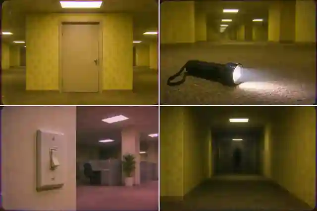
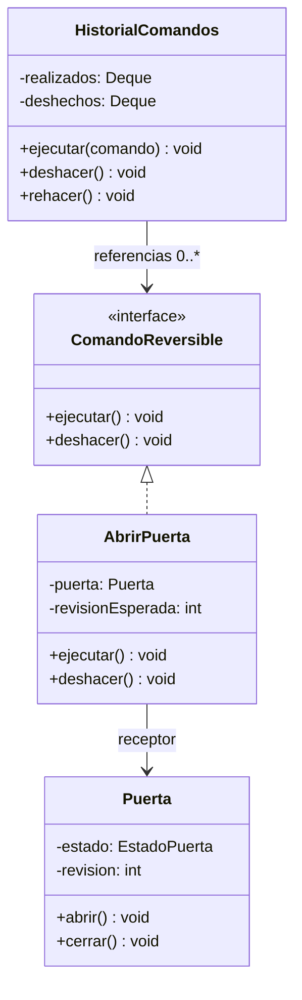

# Command: deshacer y rehacer una apertura de puerta



Primero lee [Command clásico](../../../patrones/comportamiento/command.md), donde un panel ejecuta órdenes intercambiables. La variante añade historial y una restricción nueva: **deshacer no significa restaurar a la fuerza un estado anterior**.

## Escena y reglas

Un comando `AbrirPuerta` abre una puerta inicialmente CERRADA. Se puede deshacer cerrándola y rehacer abriéndola otra vez. Pero ¿qué pasa si otra acción cerró y volvió a abrir la puerta? El estado visible sería otra vez ABIERTA, aunque el mundo cambió.

Por eso la puerta mantiene una **revisión de transición**: cada cambio válido incrementa ese número. El comando guarda la revisión esperada y rechaza un deshacer/rehacer obsoleto **antes de tocar la puerta**.

**R-LOCAL-COMMAND-01:** el historial solo mueve un comando a la pila de deshechos o realizados después de que su operación termine correctamente. Un rechazo no muta la puerta ni las pilas. Las transiciones obedecen R-05 y R-12; la revisión es un detalle local de control de concurrencia conceptual, **sin hilos**.

## UML



## Consola

```text
INICIO: CERRADA
EJECUTAR: ABIERTA
DESHACER: CERRADA
REHACER: ABIERTA
```

**Ruta:** [ClienteDeshacer](../../../../src/main/java/liminal/comportamiento/command/variantes/deshacer/ClienteDeshacer.java) → [HistorialComandos](../../../../src/main/java/liminal/comportamiento/command/variantes/deshacer/HistorialComandos.java) → [AbrirPuerta](../../../../src/main/java/liminal/comportamiento/command/variantes/deshacer/AbrirPuerta.java) → [Puerta](../../../../src/main/java/liminal/comportamiento/command/variantes/deshacer/Puerta.java) → [PruebaDeshacer](../../../../src/test/java/liminal/comportamiento/command/variantes/deshacer/PruebaDeshacer.java).

**Cuándo no usarlo:** si no existe una operación inversa segura, el comando debe declararla no reversible o usar otra política explícita; no debemos fingir que toda acción admite undo.
