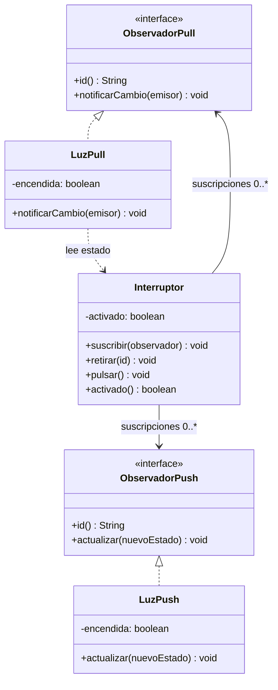

# Observer: notificación push frente a pull


El [Observer principal](../../../patrones/comportamiento/observer.md) enseña suscripción, referencias y avisos síncronos. Esta variante muestra dos políticas **distintas de contenido del mensaje**, sin convertirlas en eventos asíncronos.

## Escena y distinción

El interruptor `I-01` enciende una luz y luego la apaga. Dos observadores reciben notificaciones:

- **Push:** `LuzPush.actualizar(boolean nuevoEstado)` recibe directamente el valor actualizado.
- **Pull:** `LuzPull.notificarCambio(Interruptor emisor)` recibe una referencia al **mismo interruptor** y consulta `emisor.activado()`.

No se duplica la luz ni el interruptor. Los observadores pueden retirarse y dejar de recibir cambios.

**R-LOCAL-OBSERVER-02:** los IDs de observador son únicos dentro de cada interruptor y el orden de notificación es reproducible: primero push y después pull, respetando el orden de alta dentro de cada grupo. **Al comenzar cada pulsación se toma una instantánea de ambos grupos.** Si un observador se retira durante su propio aviso, los demás destinatarios de esa instantánea reciben el evento; el retirado no recibe los eventos siguientes. Un observador añadido durante el aviso participa a partir de la pulsación siguiente. El ejemplo solo incorpora receptores sin fallos; no pretende garantizar transacciones cuando un observador arbitrario lanza una excepción. Es **síncrono**, respeta R-07 y R-11 y no introduce hilos.

## UML de clases



Las líneas de suscripción son **asociaciones**, no agregaciones ni composiciones obligatorias.

## Consola

```text
PUSH tras pulsar: ENCENDIDA
PULL tras pulsar: ENCENDIDA
PUSH después: APAGADA
PULL sin suscripción: ENCENDIDA
```

**Ruta:** [ClientePushPull](../../../../src/main/java/liminal/comportamiento/observer/variantes/pushpull/ClientePushPull.java) → [Interruptor](../../../../src/main/java/liminal/comportamiento/observer/variantes/pushpull/Interruptor.java) → [LuzPush](../../../../src/main/java/liminal/comportamiento/observer/variantes/pushpull/LuzPush.java) y [LuzPull](../../../../src/main/java/liminal/comportamiento/observer/variantes/pushpull/LuzPull.java) → [PruebaPushPull](../../../../src/test/java/liminal/comportamiento/observer/variantes/pushpull/PruebaPushPull.java).

**Cuándo elegir:** push cuando el mensaje ya trae lo necesario; pull cuando el receptor quiere consultar más información del emisor o este controla el estado autorizado de lectura. Pull acopla el receptor al contrato de consulta del emisor; push puede requerir payloads mayores.
