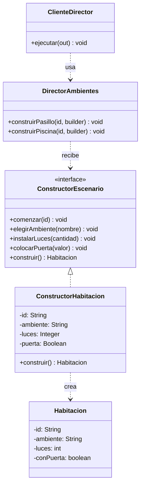

# Builder con Director: repetir una receta sin repetir el cliente


Primero estudia el [Builder fluido original](../../../patrones/creacionales/builder.md). Este ejercicio agrega un rol del esquema GoF tradicional: el **Director**, encargado del orden de los pasos.

## Problema

Si muchos clientes quieren preparar una habitación de pasillo o de piscina con la misma secuencia de configuración, duplicar los pasos es innecesario. En esta variante, `DirectorAmbientes` guarda esas recetas y conoce **el contrato abstracto** `ConstructorEscenario`, no la clase que lo implementa.

La clase `ConstructorHabitacion` recopila la configuración y crea `Habitacion`, el producto final. Todas son clases o interfaces tradicionales.

## Roles UML



No hay composición UML inferida de `new`. El Builder es reutilizable, pero las habitaciones entregadas son instancias diferentes que conservan su propia configuración.

**Regla local R-LOCAL-BUILDER-02:** las recetas de pasillo y piscinas deben ser deterministas; cada llamada `comenzar(id)` inicia una construcción nueva. Un ID vacío o una configuración inválida se rechaza sin entregar un producto parcial. No se registran habitaciones en un mapa ni se modifican estados de puertas.

## Consola

```text
H-01: Pasillo amarillo / luces 4 / puerta sí
H-02: Piscina vacía / luces 2 / puerta no
```

**Orden para leer:** [ClienteDirector.java](../../../../src/main/java/liminal/creacionales/builder/variantes/director/ClienteDirector.java) → [DirectorAmbientes.java](../../../../src/main/java/liminal/creacionales/builder/variantes/director/DirectorAmbientes.java) → [ConstructorEscenario.java](../../../../src/main/java/liminal/creacionales/builder/variantes/director/ConstructorEscenario.java) → [ConstructorHabitacion.java](../../../../src/main/java/liminal/creacionales/builder/variantes/director/ConstructorHabitacion.java) → [Habitacion.java](../../../../src/main/java/liminal/creacionales/builder/variantes/director/Habitacion.java) → [PruebaDirector.java](../../../../src/test/java/liminal/creacionales/builder/variantes/director/PruebaDirector.java).

```bash
java -cp colecciones/liminal/out liminal.creacionales.builder.variantes.director.ClienteDirector
```

**Cuándo no usar Director:** si solo hay una construcción aislada con pasos claros, el Builder fluido original es suficiente y tiene menos clases. Añadir Director no hace automáticamente más profesional el diseño.
