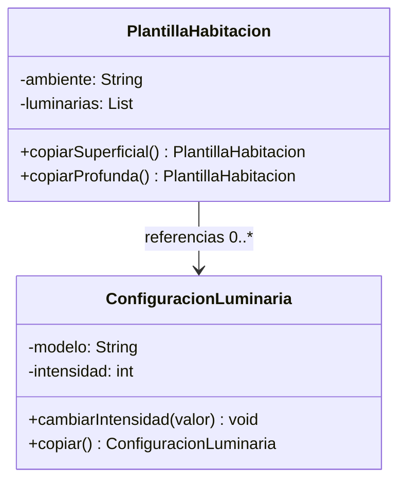
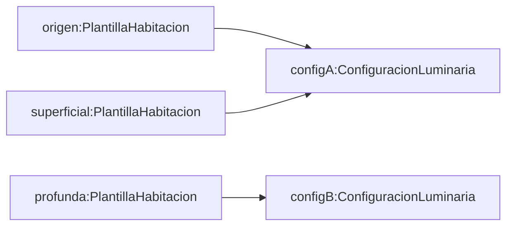

# Prototype: copia superficial frente a copia profunda


**Lee primero:** [Prototype clásico](../../../patrones/creacionales/prototype.md). Aquí aprenderemos una diferencia de **referencias Java**, no una regla nueva del mundo.

## Escena y decisión de ingeniería

Una plantilla de habitación tiene configuraciones de luminarias con modelo e intensidad. **Son configuraciones editables**, no luminarias instaladas ni artefactos físicos de una expedición.

- `PlantillaHabitacion` conserva una lista de referencias a `ConfiguracionLuminaria`.
- `copiarSuperficial()` crea una nueva plantilla, **reutilizando** los objetos de configuración.
- `copiarProfunda()` crea también nuevos objetos de configuración, preservando sus valores.

**R-LOCAL-PROTOTYPE-01:** cambiar intensidad en una copia profunda no afecta al origen; un cambio en la copia superficial sí puede afectarlo por compartir la referencia. Intensidades válidas: 0..100. Un rechazo no cambia el estado.

**R-06 y R-10:** esta copia ocurre antes de crear entidades activas; no se duplica físicamente una linterna, no hay dos inventarios ni habitaciones nuevas con ID repetido.

## UML de clases y esquema de referencias



**Esquema de objetos y aliasing**, complementario al UML de clases:



La flecha significa **referencia a un objeto**, no composición UML. En la copia profunda, A y B empiezan con iguales valores, pero no son la misma instancia.

## Salida de consola

```text
SUPERFICIAL comparte configuración: true
PROFUNDA comparte configuración: false
ORIGEN tras modificar copia superficial: 80
ORIGEN tras modificar copia profunda: 80
PROFUNDA modificada: 20
```

**Lee el código en este orden:** [ClienteCopiaProfunda](../../../../src/main/java/liminal/creacionales/prototype/variantes/copiaprofunda/ClienteCopiaProfunda.java), [PlantillaHabitacion](../../../../src/main/java/liminal/creacionales/prototype/variantes/copiaprofunda/PlantillaHabitacion.java), [ConfiguracionLuminaria](../../../../src/main/java/liminal/creacionales/prototype/variantes/copiaprofunda/ConfiguracionLuminaria.java) y [PruebaCopiaProfunda](../../../../src/test/java/liminal/creacionales/prototype/variantes/copiaprofunda/PruebaCopiaProfunda.java).

Ejecutar, después de compilar con el script de la colección:

```bash
java -cp colecciones/liminal/out liminal.creacionales.prototype.variantes.copiaprofunda.ClienteCopiaProfunda
```

**Cuándo elegir cuál:** superficial si compartir la configuración es intencional; profunda si hace falta independencia de modificaciones y se acepta crear más objetos. Ninguna es «la variante más profesional» en todos los contextos.
