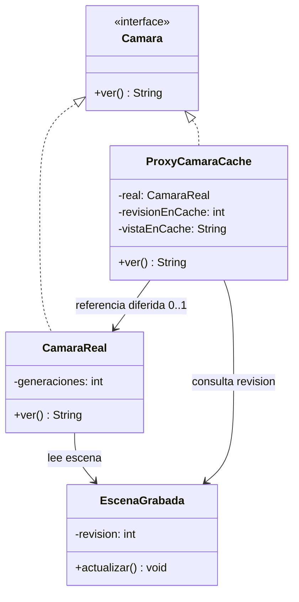

# Proxy: caché con invalidación por revisión


Primero revisa el [Proxy clásico](../../../patrones/estructurales/proxy.md), que controla el acceso y crea la cámara real de forma perezosa. Esta variante **no repite la autorización**: resuelve otro problema.

## Problema y variante

Consultar reiteradamente una vista ficticia puede repetir trabajo. `ProxyCamaraCache` implementa el contrato `Camara` y guarda una vista por revisión de `EscenaGrabada`. La cámara real solo se crea en la primera consulta. Una segunda consulta reutiliza la vista; una acción discreta `escena.actualizar()` incrementa la revisión y obliga a regenerarla.

No hay red, imagen real, tiempo de espera ni reloj: **contamos cuántas veces se genera la vista** para tener una evidencia reproducible.

**R-LOCAL-PROXY-01:** una vista almacenada es válida si y solo si su revisión coincide con la revisión actual de la escena. Un cambio de revisión invalida el valor sin destruir la identidad de la cámara. Se conservan R-11 y R-12.

## UML de colaboración



Referenciar la cámara real no implica por sí solo composición UML.

## Resultado visible

```text
GENERACIONES antes: 0
Vista: Pasillo amarillo (revisión 0)
GENERACIONES primera consulta: 1
GENERACIONES segunda consulta: 1
Vista: Pasillo amarillo (revisión 1)
GENERACIONES tras cambio: 2
```

**Ruta:** [ClienteProxyCache](../../../../src/main/java/liminal/estructurales/proxy/variantes/cache/ClienteProxyCache.java) → [ProxyCamaraCache](../../../../src/main/java/liminal/estructurales/proxy/variantes/cache/ProxyCamaraCache.java) → [CamaraReal](../../../../src/main/java/liminal/estructurales/proxy/variantes/cache/CamaraReal.java) → [PruebaProxyCache](../../../../src/test/java/liminal/estructurales/proxy/variantes/cache/PruebaProxyCache.java).

**Cuándo no usarlo:** si la vista cuesta poco o cambia constantemente, mantener versiones y caché puede costar más que pedirla directamente.
