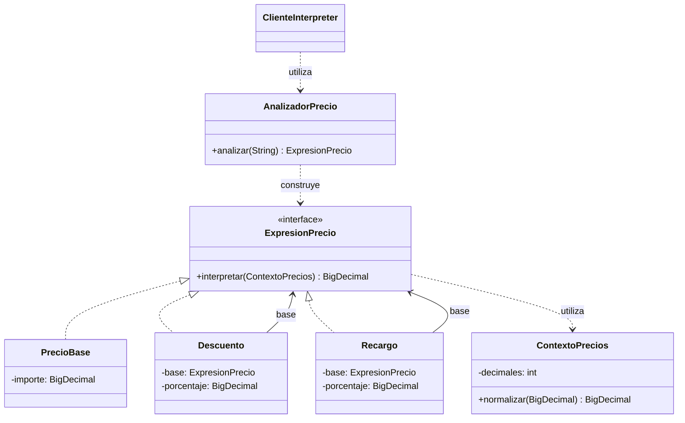

# Interpreter — un lenguaje mínimo de precios

Este ejemplo pertenece a la **colección técnica original** de los patrones GoF. Complementa la [versión visual de Expedición Liminal](../../../liminales/docs/patrones/comportamiento/interpreter.md), pero utiliza un dominio comercial sencillo: calcular precios a partir de instrucciones escritas.

## 1. Problema y pequeña gramática

Queremos interpretar expresiones de descuento y recargo **sin ejecutar código Java, scripts o SQL recibidos de una persona**. Solo admitimos una gramática explícita:

```text
expresión ::= IMPORTE
            | DESCUENTO expresión PORCENTAJE
            | RECARGO   expresión PORCENTAJE
IMPORTE    ::= número decimal no negativo
PORCENTAJE ::= número decimal de 0 a 100
```

Usamos **notación prefija**, que hace sencilla la interpretación recursiva:

```text
DESCUENTO 100 10                  → $90.00
DESCUENTO RECARGO 100 5 10        → $94.50
RECARGO DESCUENTO 200 20 5        → $168.00
```

La última expresión se entiende como «aplica 20 % de descuento a 200; después, 5 % de recargo al resultado».

## 2. Roles del patrón GoF



- **Expresión terminal:** `PrecioBase` devuelve un importe.
- **Expresiones no terminales:** `Descuento` y `Recargo` contienen una **referencia** a otra expresión y aplican una operación a su resultado.
- **Contexto:** `ContextoPrecios` fija la precisión decimal y el redondeo.
- **Analizador:** `AnalizadorPrecio` crea un árbol de expresiones a partir del texto. La gramática no es una librería general; acepta exactamente estos operadores.
- **Cliente:** `ClienteInterpreter` crea el analizador, interpreta el árbol e imprime su resultado.

**Importante:** el objeto de expresión compuesto de otros objetos no implica por sí solo una **composición UML**. Para afirmar propiedad exclusiva necesitaríamos reglas de ciclo de vida que este ejercicio no declara.

## 3. Árbol de una expresión

```text
RECARGO DESCUENTO 200 20 5

           Recargo (5 %)
                |
          Descuento (20 %)
                |
          PrecioBase (200)

200.00 → 160.00 → 168.00
```

El analizador construye el árbol; las llamadas `interpretar(contexto)` recorren el árbol recursivamente para producir el resultado. El cliente desconoce las clases de los nodos mientras evalúa la interfaz común.

## 4. Validaciones y límites

- Se rechazan precios negativos, porcentajes fuera de `0..100`, texto vacío, operaciones desconocidas, argumentos incompletos y tokens sobrantes.
- Se utiliza `BigDecimal` para aritmética decimal, con **2 decimales** y redondeo `HALF_UP` en cada paso del árbol.
- No se modelan impuestos reales, políticas fiscales, divisas, promociones combinadas de una empresa ni cálculos contables de producción.
- No se necesita JavaFX, Maven, conexión a Internet, `eval` ni motor de scripts.

## 5. Ejecutar y comprobar

Desde la raíz del repositorio:

```bash
javac --release 21 -encoding UTF-8 -d out/clasicos patrones/clasicos/comportamiento/Interpreter/*.java
java -cp out/clasicos comportamiento.Interpreter.ClienteInterpreter
```

También se ejecuta desde `ProbarComportamiento.probarInterpreter()` y forma parte de `bash scripts/verificar.sh`, que comprueba una salida esperada y ejecuta las pruebas del cliente.

**Cuándo no usar Interpreter:** si solamente quieres elegir entre dos o tres botones, un `switch` o Command puede ser suficiente. Este patrón cobra valor cuando tienes **una gramática definida que produce expresiones componibles** y quieres separar análisis de interpretación.

[Volver al README principal](../../../../README.md) · [Guía UML general](../../../../UML_GUIDE.md).
