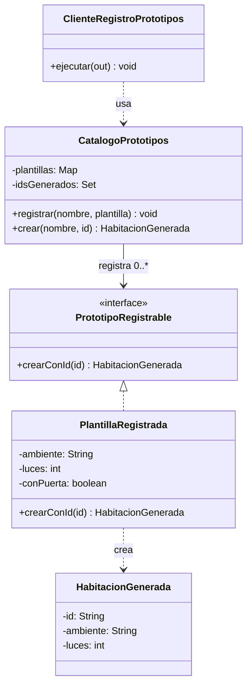

# Prototype Registry: un catálogo de plantillas liminales


**Lee primero:** [Prototype clásico](../../../patrones/creacionales/prototype.md). Este ejemplo añade un **registro de prototipos**, útil cuando el cliente elige una configuración por nombre y no debe conocer sus clases concretas.

## Escena

El catálogo guarda una plantilla del pasillo amarillo y otra de piscinas. Ninguna plantilla tiene ID de habitación activa. Cuando el cliente solicita `crear("amarillo", "H-01")`, el catálogo recupera el prototipo y pide una **nueva instancia de habitación**.

**R-LOCAL-PROTOTYPE-02:** las claves del catálogo son únicas. Cada habitación creada por este catálogo recibe un ID no vacío, no utilizado previamente **dentro del catálogo**. Una plantilla ausente o un ID duplicado se rechaza **antes** de modificar el registro de IDs.

**Relación con R-01, R-10 y R-13:** el catálogo garantiza unicidad local; registrar esa habitación en un mapa más amplio aún debe respetar las restricciones de ese mapa. Cambiar de ambiente no cambia las reglas de identidad o tránsito.

## Roles y UML



La asociación con las plantillas **no demuestra composición**. El catálogo no es una abstracción común obligatoria para todas las habitaciones del mundo: es infraestructura local de esta variante.

## Consola y aprendizaje

```text
H-01: Pasillo amarillo / luces: 4
H-02: Piscina vacía / luces: 2
```

El cliente pide resultados por clave; `PrototipoRegistrable` conserva la capacidad de fabricar un objeto nuevo con otra identidad. Las pruebas verifican duplicados, clave ausente y que un rechazo no consuma IDs.

**Ruta de lectura:** [ClienteRegistroPrototipos](../../../../src/main/java/liminal/creacionales/prototype/variantes/registro/ClienteRegistroPrototipos.java) → [CatalogoPrototipos](../../../../src/main/java/liminal/creacionales/prototype/variantes/registro/CatalogoPrototipos.java) → [PrototipoRegistrable](../../../../src/main/java/liminal/creacionales/prototype/variantes/registro/PrototipoRegistrable.java) → [PlantillaRegistrada](../../../../src/main/java/liminal/creacionales/prototype/variantes/registro/PlantillaRegistrada.java) → [PruebaRegistroPrototipos](../../../../src/test/java/liminal/creacionales/prototype/variantes/registro/PruebaRegistroPrototipos.java).

```bash
java -cp patrones/liminales/out liminal.creacionales.prototype.variantes.registro.ClienteRegistroPrototipos
```

**Cuándo no usarlo:** si solo hay una plantilla fija y se construye una única habitación, llamar directamente al prototipo resulta más simple que mantener un catálogo.
