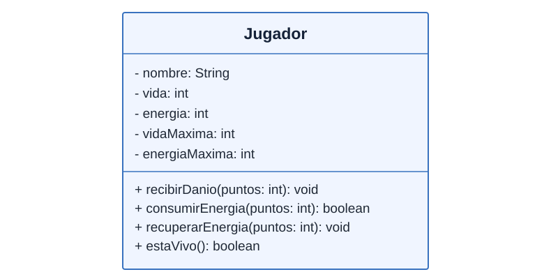
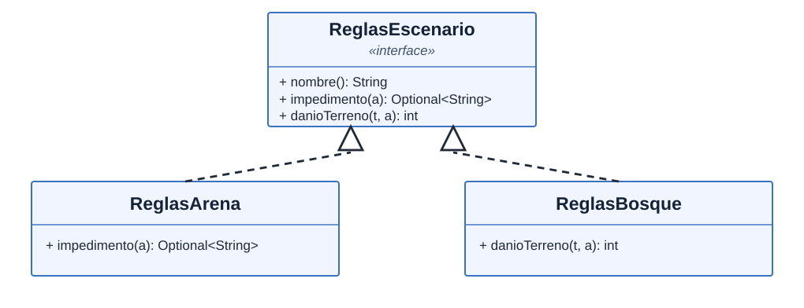
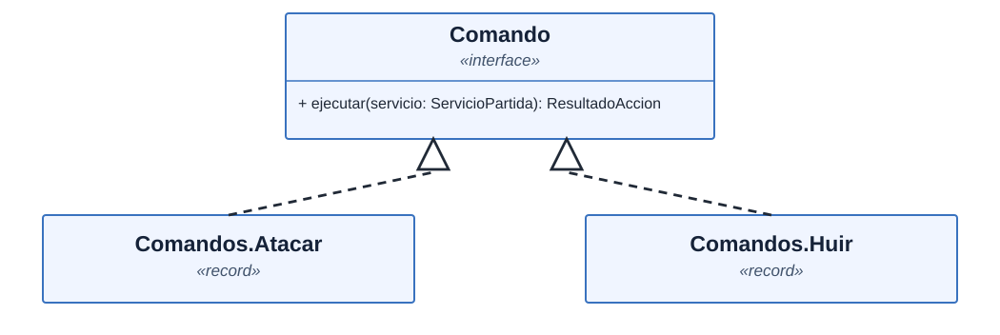
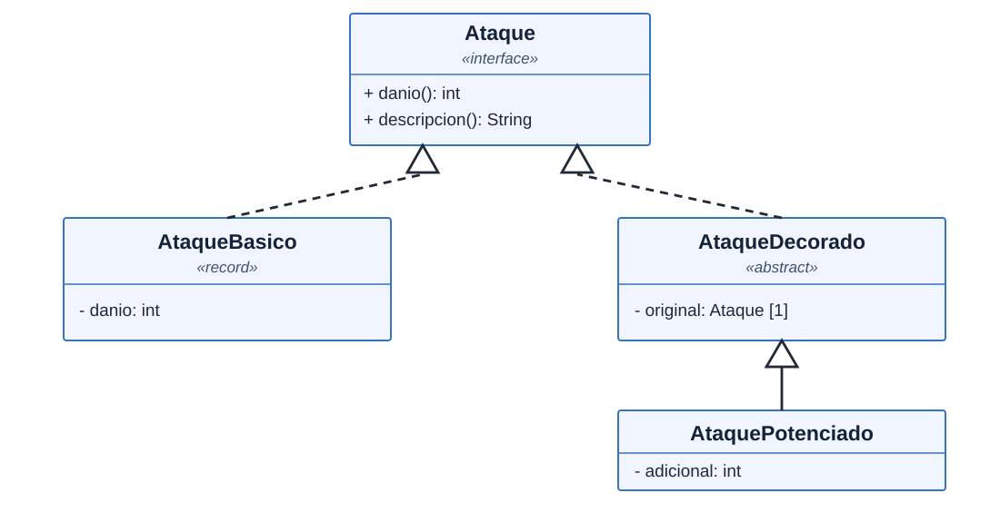
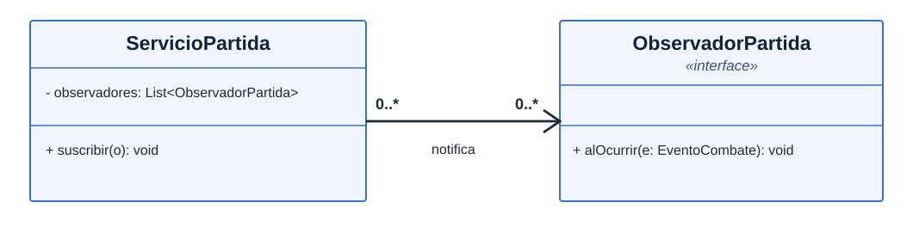
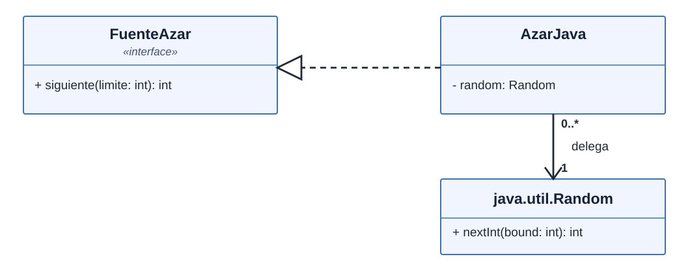

# Arena Java: un juego pequeño para estudiar diseño

Un personaje contra un adversario en un combate **por turnos**, con dos
escenarios de reglas distintas. Todo funciona en una consola de texto con
**Java 21 y su biblioteca estándar**; no usa JavaFX, Spring Boot ni bibliotecas
externas para ejecutarse. Maven es **opcional**: también se compila con
`javac` directamente.

No es un motor gráfico: el ASCII muestra únicamente vida, energía, turno y
acciones. La finalidad es justificar las clases, los patrones y las reglas
que hacen funcionar un juego sencillo.

Para aprender la herramienta de compilación desde cero, empieza por
**[BUILD.md](BUILD.md)**: JDK, `javac`, Maven, classpath, pruebas,
empaquetado JAR, limpieza y errores frecuentes. Los comandos siguientes
son la versión rápida sin Maven.

## Jugar

Desde la raíz del repositorio, con Java 21 instalado:

**Git Bash o Linux**

```bash
mkdir -p out
find proyectos/arena-java/src -name '*.java' -print0 | xargs -0 javac -encoding UTF-8 -d out
java -cp out arena.presentacion.ArenaJava
```

**PowerShell**

```powershell
New-Item -ItemType Directory -Force out | Out-Null
$archivos = Get-ChildItem .\proyectos\arena-java\src -Recurse -Filter *.java | ForEach-Object FullName
javac -encoding UTF-8 -d out $archivos
java -cp out arena.presentacion.ArenaJava
```

Elige **1 = Arena** o **2 = Bosque**. Después puedes utilizar:

| Orden | Caso de uso | Acción | Regla observable |
| --- | --- | --- | --- |
| 1 | CU-J01 | Atacar | Golpe de 4 a 6 puntos |
| 2 | CU-J02 | Defender | Reduce en 2 el próximo golpe y recupera 1 energía |
| 3 | CU-J03 | Especial | Consume 3 de energía; añade 3 de daño con Decorator |
| 4 | CU-J04 | Saltar | Solo en bosque: esquiva las raíces cuando aparecen |
| 5 | CU-J05 | Huir | Solo en bosque: termina el encuentro sin victoria |
| 0 | — | Salir | Detiene la ejecución, sin cerrar procesos externos |

Los códigos CU-J01…05 identifican **intenciones de la persona que juega**,
no cada método privado que colabora en su implementación.

El adversario responde después de una acción válida, salvo que sea derrotado
o que el personaje huya. En el bosque, las raíces dañan **cada tercer turno**
si no saltas. La pantalla avisa cuando el peligro está activo. Una orden
prohibida o un especial sin energía **no consume turno**.

## Diseño por responsabilidades

| Paquete | Contenido | Ejemplo |
| --- | --- | --- |
| `dominio` | Entidades, reglas y mecánicas sin consola | `Jugador`, `Partida`, `MotorCombate` |
| `aplicacion` | Caso de uso y coordinación de órdenes | `ServicioPartida`, `Comando` |
| `infraestructura` | Adaptación de una API técnica | `AzarJava` |
| `presentacion` | Entrada y salida textual | `ConsolaArena`, `RenderizadorAscii` |

No existe un árbitro como personaje: `MotorCombate` es un **servicio de
dominio** porque aplica una interacción entre dos entidades. `Jugador`
conserva sus invariantes: la vida nunca baja de cero y la energía nunca supera
su máximo. `ServicioPartida` coordina el caso de uso y no reimplementa esas
reglas internas.



Fuente: [jugador.uml](docs/uml/jugador.uml). Observa que `Jugador`
no es una *Data Class*: sus métodos protegen vida y energía. Los `record`
se usan para mensajes y resultados, no para vaciar de comportamiento la entidad.

### UML: Strategy para cambiar de escenario



Fuente editable: [escenarios.uml](docs/uml/escenarios.uml).
La línea **discontinua con triángulo hueco** significa realización de una
interfaz, no herencia entre clases. La decisión de qué acciones se permiten
pertenece al escenario, no a un `if` que pregunte el tipo del escenario.

### Por qué aparecen estos patrones

| Patrón | Problema que resuelve en el juego | Código |
| --- | --- | --- |
| Strategy | Dos terrenos con restricciones distintas | `ReglasEscenario` y sus implementaciones |
| Command | Interpretar órdenes sin mezclar lectura de teclado con combate | `Comando`, `Comandos` |
| Decorator | Potenciar un ataque manteniendo su contrato | `AtaquePotenciado` |
| Observer | Informar a la interfaz sin imprimir desde el dominio | `ObservadorPartida` |
| Adapter | Cambiar el azar real por uno predecible en pruebas | `FuenteAzar` y `AzarJava` |

### UML: Command



Fuente: [comandos.uml](docs/uml/comandos.uml). El diagrama muestra dos órdenes;
`Defender`, `Especial` y `Saltar` implementan el mismo contrato. La consola
interpreta el teclado y construye un comando; este delega en el servicio de
aplicación.

### UML: Decorator



Fuente: [decorador.uml](docs/uml/decorador.uml). `AtaqueDecorado` guarda
**una referencia** a otro `Ataque` (`[1]`). `AtaquePotenciado` añade daño
sin modificar `AtaqueBasico`. La línea continua con triángulo hueco significa
herencia, y la discontinua, realización de una interfaz.

### UML: Observer y lectura de cardinalidades



Fuente: [observador.uml](docs/uml/observador.uml).

- Para cada **ServicioPartida**, el `0..*` junto a **ObservadorPartida**
  significa cero o muchos receptores.
- Para cada **ObservadorPartida**, el `0..*` junto a **ServicioPartida**
  significa que el mismo receptor podría suscribirse a varios servicios.
- La flecha abierta indica que el servicio **conoce y notifica** al receptor,
  no cuántos receptores existen.

`EventoCombate` es un `record` con un `Tipo` de evento y un mensaje. Esto
permite reaccionar a `VICTORIA` o `ATAQUE` **sin analizar cadenas de texto**;
el renderizador únicamente presenta el mensaje.

### UML: Adapter



Fuente: [adaptador.uml](docs/uml/adaptador.uml). Cada `AzarJava` conoce
exactamente un `Random` (`1` junto a Random); un mismo `Random` puede
compartirse entre varios adaptadores. El dominio depende de `FuenteAzar`,
no de la API técnica concreta.

### Reglas y excepciones

La cadena de reglas **`dominio.ReglasAccion`** comprueba, en orden, que la
partida esté activa, que el escenario permita la acción y que exista energía
suficiente. **No todo `if` es un problema**: aquí se concentran las
decisiones que de otro modo se repetirían en cada comando.

Tanto `ServicioPartida` como `MotorCombate` consultan el mismo contrato
del dominio: llamar directamente al motor no permite eludir las reglas.

El rechazo de una acción es un resultado normal representado por
`ResultadoAccion.Rechazada`, no una excepción. Las excepciones se reservan
para argumentos imposibles o violaciones de contratos del programador.

El `enum Estado` de `Partida` **no se presenta falsamente como el patrón
State**: para los cuatro finales posibles no hace falta ese patrón.

## Probar sin dependencias

Después de compilar, desde la raíz:

```bash
java -cp out arena.PruebasArena
```

Las pruebas usan azar fijo y cubren restricciones de cada entorno —también
ante llamadas directas al motor—, gasto de energía, daño, defensa, trampas,
victoria, derrota, huida, eventos Observer tipados, invariantes y la
presentación ASCII, incluido el fin inesperado de la entrada. GitHub Actions
las ejecuta con Java 21 en cada pull request, tanto con `javac` como Maven.

## Qué no incluye

No hay movimiento por coordenadas, inventarios, guardado de partidas, red,
persistencia ni concurrencia real. El salto no es una animación: representa
una decisión táctica contra las raíces. Estas omisiones son deliberadas para
mantener el código pequeño y comprensible.
