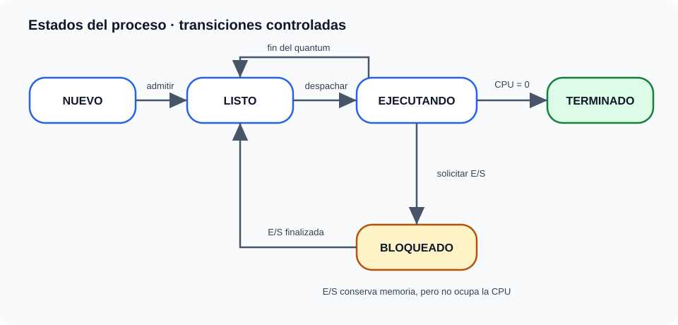
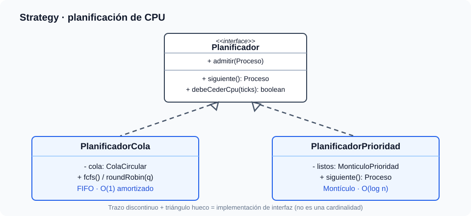
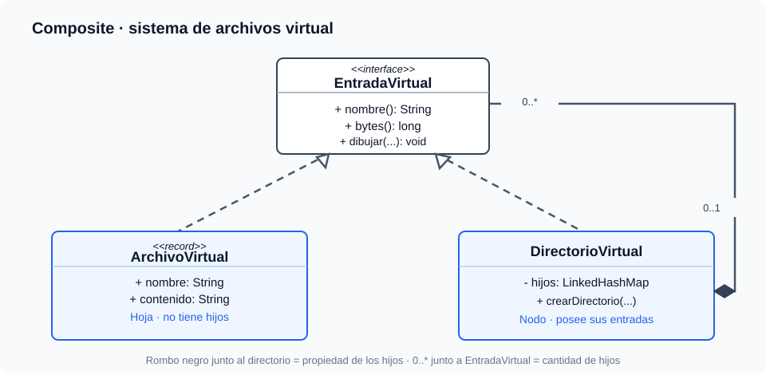

# MiniSO: una maqueta de sistema operativo en Java 21

MiniSO **no es un sistema operativo**, ni instala controladores, ni crea
procesos del equipo. Es una **simulación determinista de CPU, memoria, E/S y
archivos virtuales** para entender por qué las estructuras de datos y los
patrones de diseño importan. No necesita Hibernate, base de datos, JavaFX,
Spring Boot, privilegios de administrador ni bibliotecas de ejecución externas.

Sigue [BUILD.md](BUILD.md) para empezar desde cero con JDK, `javac`, Maven,
classpath, JAR y fases de construcción, como si estuvieras aprendiendo CMake.

## Un ejemplo que puedes visualizar

Imagina una computadora de juguete con **32 KiB de memoria** (ficticia):
quieres ejecutar un reproductor de música, un editor y un videojuego.
Cada proceso tiene cierto trabajo de CPU, prioridad y memoria reservada.
La pregunta de dominio es: **¿quién utiliza la CPU cuando hay varios listos?**

Ejecuta `java -cp out miniso.presentacion.MiniSO` tras compilar, elige
`2` (Round Robin), y escribe:

```text
crear musica 4 2 8
crear editor 3 5 8
crear juego 2 9 12
ps
tick 2
estado
tick 7
ps
mkdir /mis_notas
write /mis_notas/idea.txt hoy estudie estructuras
cat /mis_notas/idea.txt
tree
salir
```

`tick` es una **unidad de tiempo simulada**, no un segundo real: puedes
reproducir la misma secuencia todas las veces. La memoria se libera cuando
un proceso termina. Si excede 32 KiB, la nueva admisión se **rechaza sin
alterar el estado**, como un resultado normal, no como una excepción.

| Comando | Caso de uso | Qué demuestra |
| --- | --- | --- |
| `crear nombre cpu prioridad KiB` | CU-SO01 | Admisión y memoria limitada |
| `tick [n]` | CU-SO02 | CPU y política de planificación |
| `io n` | CU-SO03 | El proceso ejecutando se bloquea y libera CPU |
| `ps`, `estado` | CU-SO04 | Estado observable sin exponer objetos mutables |
| `mkdir /ruta` | CU-SO05 | Crear un nodo de directorio |
| `write /ruta texto` | CU-SO06 | Crear o reemplazar archivo en memoria |
| `cat /ruta` | CU-SO07 | Leer un archivo virtual |
| `tree` | CU-SO08 | Recorrer un árbol recursivamente |

`io` requiere que exista un proceso **en ejecución**: después de `tick 1`,
si la política no acaba de desalojarlo, puedes ejecutar `io 2`. Durante los
dos próximos ticks avanza su E/S paralelamente a la CPU; cuando termina la
espera vuelve a LISTO **al final del tick**, nunca retroactivamente.

## Arquitectura: dominio frente a reglas de la computadora

| Paquete | Responsabilidad | Ejemplos |
| --- | --- | --- |
| `dominio` | Entidad y transiciones válidas | `Proceso`, `EstadoProceso`, `DirectorioVirtual` |
| `aplicacion` | Coordinar casos de uso, recursos y políticas | `SimuladorSO`, `Planificador`, `SistemaArchivosVirtual` |
| `estructuras` | Algoritmos reutilizables escritos desde cero | `ColaCircular`, `MonticuloPrioridad` |
| `presentacion` | Traducir texto y presentar resultados | `ConsolaMiniSO`, `MiniSO` |

No añadimos un paquete `infraestructura` vacío: **no hay adaptadores de red,
disco, reloj externo o base de datos**. Si algún día conectamos el simulador
con uno de esos recursos, aparecerá entonces su implementación concreta y
su contrato de entrada. Una buena arquitectura no obliga a crear capas sin
responsabilidad real.

`Proceso` **no es un formulario vacío**: controla que un proceso NUEVO no
ejecute CPU, uno BLOQUEADO no corra mientras espera E/S y uno TERMINADO no
resucite. `VistaProceso` sí es un `record`, pues solo transporta una foto
inmutable para mostrar en pantalla. Una clase de dominio protege reglas;
un `record` es apropiado para transportar datos inmutables.



Fuente editable: [estados-proceso.uml](docs/uml/estados-proceso.uml).
La transición LISTO → EJECUTANDO ocurre al despachar CPU; EJECUTANDO → LISTO
ocurre al agotar el *quantum*; la terminación libera memoria. Esta máquina
de estados está implementada con un `enum` y métodos con invariantes;
**no estamos usando aquí el patrón State**.

## Strategy: el planificador se cambia, el proceso no



Fuente editable: [planificacion.uml](docs/uml/planificacion.uml).
La línea **discontinua con triángulo hueco** simboliza la realización de
una interfaz. No representa cardinalidad: una clase implementa el contrato.

| Política | Comportamiento | Estructura real en código | Coste de espera |
| --- | --- | --- | --- |
| FCFS | El primero mantiene CPU hasta terminar o bloquearse | Arreglo circular FIFO propio | Alta O(1) amortizado, extracción O(1) |
| Round Robin | Cede CPU tras **2 ticks** consecutivos | El mismo FIFO, reencolando al desalojar | Alta O(1) amortizado, extracción O(1) |
| Prioridad | Al liberarse CPU elige prioridad más alta (9); empate por llegada a cola | Montículo binario máximo propio | Alta y extracción O(log n) |

Para comparar justamente, ejecuta **sesiones distintas con la misma carga**.
La política se elige **antes de dar de alta procesos**: cambiarla a mitad de
un turno requeriría definir cómo migrar el estado del planificador.

Las tres políticas pueden producir **esperas injustas**: FCFS retiene CPU
tras un trabajo largo; Round Robin introduce cambios frecuentes de turno;
la prioridad no expropiativa puede postergar indefinidamente trabajos de
prioridad baja si siguen llegando otros más urgentes. No implementamos
*aging* ni cambios de contexto reales, y no llamamos «tiempo de CPU» al
tiempo de reloj del ordenador.

## De la relación UML a la estructura de datos



Fuente editable: [archivos-composite.uml](docs/uml/archivos-composite.uml).

La **composición** (rombo negro en `DirectorioVirtual`) significa que el
directorio **posee sus entradas**; cada directorio tiene de `0..*` hijos.
Lee la cardinalidad así: «para cada directorio puede haber cero o muchas
entradas». Cada entrada tiene **a lo sumo un directorio padre**; la raíz no
tiene ninguno. En Java esa relación se materializa con un
`LinkedHashMap<String, EntradaVirtual>`: clave para buscar por nombre y
orden de inserción para mostrar el árbol de modo reproducible.

Composite hace que un archivo y un directorio respondan a `bytes()` y
`dibujar(...)`. El archivo es **hoja**; el directorio, **nodo interno** que
delega recursivamente en sus hijos. Un sistema de carpetas es una forma
casera y concreta de entender la misma estructura que se usa en menús,
documentos anidados o hilos de respuestas.

| Operación del árbol | Complejidad aproximada |
| --- | --- |
| Buscar por ruta de profundidad `d` | O(d) promedio: un mapa por nivel |
| Crear un hijo | O(1) promedio por mapa, sin contar búsqueda del padre |
| Calcular bytes de todo el árbol | O(n) archivos/directorios más tamaño de textos codificados |
| Dibujar el árbol | O(n) nodos, más la longitud del texto generado |

El mapa permite buscar bien por nombre, **no** sustituye al árbol. Tampoco
sería eficiente convertir esta estructura en un grafo si no existen enlaces
entre directorios: eso añadiría ciclos y reglas que este ejercicio no tiene.

## Memoria, E/S y complejidad global

- La memoria ficticia se contabiliza con un entero: admisión y liberación
  son **O(1)**. No hay páginas, fragmentación, paginación ni `malloc` real.
- Cada tick avanza en paralelo la E/S de todos los bloqueados. Al recorrer
  procesos para encontrarlos cuesta **O(P)**, con `P` procesos registrados
  (incluidos los terminados); es deliberadamente sencillo.
- Por ello un tick cuesta **O(P + log L)** como límite superior de la
  planificación por prioridad, con `L` procesos listos. FCFS/RR tienen
  coste amortizado **O(P + 1)** por tick. No son resultados de *benchmark*.
- `LinkedHashMap` mantiene determinismo de `ps`; las estructuras hechas desde
  cero son la cola circular y el montículo, y tienen pruebas propias para
  giro, crecimiento, orden, empates y extracción.

Se podría usar `ArrayDeque` y `PriorityQueue` de Java, o estudiar variantes
en el repositorio personal de **Estructuras de Datos y Algoritmos**. Aquí se
implementaron dos versiones pequeñas y autónomas para comprender índices,
costes y casos límite **sin copiar una biblioteca completa**.

## Qué se comprueba y qué no se pretende modelar

Ejecuta `java -cp out miniso.PruebasMiniSO` (o `mvn test`). Las pruebas cubren:
FIFO tras redimensionar, heap con desempate, **6.000+ comprobaciones**
deterministas de estructuras propias contra referencias del JDK, ciclos de vida inválidos,
secuencias FCFS/RR/prioridad, E/S, memoria insuficiente y recuperación,
rechazos sin cambios laterales, rutas inválidas, recursión y consola.

No hay **kernel real**, procesos/hilos reales, sistema de archivos del equipo,
persistencia en disco, permisos, interrupciones hardware, paginación, red,
sincronización concurrente, métricas temporales ni llamadas nativas. Esa
separación entre **modelo didáctico** y **semántica real del SO** es parte
del aprendizaje, no una limitación oculta.
